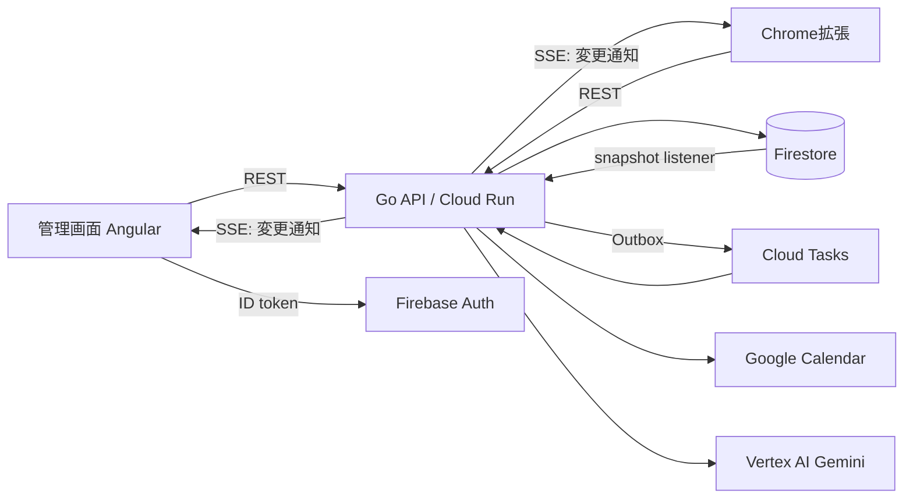

# AGENTS.md

DOPAGAKIの設計方針と、コードを書くときの決まりごと。人もAIエージェントも、変更の前にこれを読む。`CLAUDE.md` はこのファイルへのシンボリックリンクで、内容は常に同じ。

- アプリの概要と使い方：[README.md](README.md)
- ブランチ名・コミット・PRの手順：[CONTRIBUTING.md](CONTRIBUTING.md)
- 判断の経緯・不具合の記録・検証結果：[engineering/](engineering/README.md)

> **現状（2026-11-08）**：ここに書いた構成への全面的な作り直しの途中。作り直しが終わるまでは、既存のコードがこの方針に沿っていない部分がある。新しく書くコードはこの方針に従う。作り直しでは本番データを移行せず、リセットする。

## プロダクトの核

YouTube Shortsを見ている利用者を、締切から逆算した開始時刻に課題へ戻す。取り組んだ作業時間に応じて、視聴できる時間が増える。

- **AIは補助、正しさはコード。** 入力の解釈と手順の具体化はGeminiに任せる。時刻・報酬・残高・保存の整合性は通常のコードで検証し、AIの出力をそのまま確定しない。
- **確定するのは本人。** AIの提案、スヌーズの変更、記憶は、本人が確認してから保存する。
- **今は使っていない機能も残す。** モード（パチンコ・麻雀・シンプル）、画面の汚れ、相棒の一言、睡眠、iPhoneショートカット、AI相談と記憶は、今後の開発のために残している。消さない。

## リポジトリ構成

pnpm workspacesのモノレポ。各アプリ・パッケージは、自分が使う依存を自分の `package.json` に書く。

```text
apps/
  api/          Go。API・認証・報酬・外部連携。管理画面の静的ファイルも配信する
  web/          Angular。管理画面
  extension/    Chrome拡張（MV3、WXT）
packages/
  contract/     openapi.yaml と、そこから生成したTSクライアント
  bridge/       管理画面と拡張の間の postMessage の型（zodで検証）
  tokens/       M3デザイントークン（CSS変数）。webと拡張で共有
  messages/     表示文言（日本語・英語）とエラーコードの対応表。webと拡張で共有
engineering/    開発記録
deploy/         配信スクリプト、Terraform（Google Cloudの設定）、Firestoreのルール
```

- ビジネスルールのTS実装は持たない。ルールはGoだけに書き、表示に必要な値はAPIで返す。
- `packages/contract` の生成物は手で編集しない。

## ツールチェーン

バージョンは [mise.toml](mise.toml) を正とする。Nodeは [.nvmrc](.nvmrc) にも同じ値を書き、CIとDockerfileもこれに合わせる。

```bash
mise install          # Node・Go・golangci-lint・Terraform を揃える
corepack enable       # pnpm を有効にする
pnpm install
```

| 目的 | コマンド |
|---|---|
| 開発サーバー | `pnpm dev` |
| 型チェック・Lint・フォーマット確認 | `pnpm check` |
| 単体テスト（TS・Go） | `pnpm test` |
| e2e | `pnpm test:e2e` |
| 仕様からコードを生成 | `pnpm generate` |
| フォーマット | `pnpm format` |

CIは関連するLint・型・単体テストと、ログイン画面／課題登録→作業→完了のE2E2本だけを実行する。詳細E2Eは`workflow_dispatch`で必要なときに手動実行する。重要な認証・時刻・報酬・保存の単体テストと、失敗・取消・配信のガードは残す。資料・単体テスト・CI専用変更でブラウザーや本番配信を起動しない。Terraformは変更時に検証する。生成物確認は生成に影響する変更時に行う。

提出用リポジトリでは検証だけを実行し、本番配信は起動しない。配信ジョブの呼び出し側と実行側の両方で、開発用 `a-sumikawa/devfest-2026` に制限する。

影響範囲は `.github/ci-paths.yaml`、実行頻度・配信対象・テストのみの変更の扱いは `deploy/ci-policy.mjs` を正とし、両方を使った回帰テストを維持する。必要な検証の失敗・取消を成功として扱わない。APIとフロントの成功後にE2Eへ進み、省略されたAPIジョブはE2Eを妨げない。Lintやフォーマットの違反があるPRはマージしない。

mainの配信対象では、本番用イメージを一度作り、そのイメージで変更範囲に応じたE2Eを通してからCDへ渡す。CDはイメージIDを照合して同じ成果物を配信し、再ビルドしない。古いCIはジョブ単位で取り消す。本番配信は別のconcurrencyグループで直列化し、開始済みの配信は中断しない。配信開始前には最新mainかを確認する。定期実行は追加せず、手動の全件検証だけを用意する。

CI障害の復旧などで配信をやり直す場合は、承認済みPRのmainへのマージコミットに `[deploy]` を明示する。その場合だけ変更範囲にかかわらず生成物・Lint・型・単体・通常のE2E2本を確認してから配信する。PRや `workflow_dispatch` から配信せず、mainへのpushという本番認証の条件を維持する。

## アーキテクチャ

### システム全体



- Cloud Run 1サービスで、APIと管理画面を同じオリジンから配信する。
- クライアントは、FirestoreやGoogleのAPIに直接アクセスしない。必ず認証したAPIを通す。Firestoreのクライアント向けルールは全拒否にする。
- Google Cloudの設定（API、サービスアカウントと権限、Cloud Run、Cloud Tasks、Cloud Scheduler、Firestore）は `deploy/terraform` で管理する。画面やgcloudで直接変えず、Terraformを変えてapplyする。Cloud Runのイメージとトラフィックだけは CD が変える。Secretの値はTerraformに入れない。

### バックエンド：機能ごとのパッケージ ＋ ポート＆アダプター

```text
apps/api/
  cmd/server/            起動・設定の読み込み・依存の組み立てだけ
  internal/
    task/                課題・計画・逆算・スヌーズの候補
    wallet/              視聴時間（台帳・付与・消費・ルール）
    worksession/         作業タイマー
    viewing/             視聴の区切り
    sleep/
    assistant/           AI相談・記憶
    calendar/            Google Calendarとの同期（Outbox）
    realtime/            変更通知（SSE）
    platform/            clock・id・errors・config・idempotency
    adapter/
      http/              oapi-codegenで生成したstrict-serverの実装
      firestore/
      gcal/
      gemini/
      firebaseauth/
      cloudtasks/
```

機能のパッケージの中は、次の3段に分ける。

| ファイル | 役割 | 書いてはいけないもの |
|---|---|---|
| `domain.go` | エンティティ、値オブジェクト、ルール。純粋な関数 | I/O、`context`、`time.Now()`、SDKの型 |
| `service.go` | ユースケース。手順を組み立て、トランザクションの範囲を決める | HTTP、Firestore、Calendarの具体的な型 |
| `ports.go` | serviceが必要とする外部機能のインターフェース | 実装 |

- **依存の向きは `adapter → service → domain` だけ。** 逆向きや、別の機能の内部への依存は `depguard` で禁止する。
- ほかの機能を使うときは、その機能の `service` が公開するメソッドを呼ぶ。別の機能のデータを直接読み書きしない。
- インターフェースは、使う側（service）が `ports.go` に宣言する。実装する側は宣言しない。
- `cmd/server` 以外ではグローバル変数を使わず、環境変数も読まない。設定は `platform/config` で検証してから注入する。
- 起動モードの既定値は `demo`。`live` は必要な設定がすべて揃っていなければ起動しない。本番のプロジェクトIDなどを既定値に書かない。

### データモデル（Firestore）

整合性を保つ単位ごとにドキュメントを分ける。1ユーザーの全データを1つのドキュメントに入れない。

```text
users/{uid}
  meta                     リソースごとの版番号。変更通知の元になる
  profile, settings, sleep, shortcut
  tasks/{taskId}           課題と計画。計画の版番号を持つ
  session                  実行中の作業。作業中の課題は常に1つ以下
  wallet                   台帳から計算した残高と、適用済みの最後の台帳の連番
  ledger/{entryId}         台帳。追記のみ。IDはべき等キー
  viewing                  実行中の視聴の区切り
  idempotency/{key}        Idempotency-Keyと結果。TTLで自動削除
  outbox/{jobId}           外部へ反映するジョブ
assistant/...              相談の会話と記憶
```

- **視聴時間は台帳を正とする。** 付与・消費・リセットはすべて `ledger` への追記で表す。`wallet` は台帳から計算した結果を、同じトランザクションで更新したもの。`wallet` がずれても、台帳から作り直せるようにする。
- 台帳の項目は書き換えず、消さない。訂正するときは、打ち消す項目を追記する。
- 状態を変えるトランザクションでは、同時に `meta` の該当リソースの版番号を上げる。
- 日時はUTCで保存する。利用者のタイムゾーンは `profile` に持ち、計算するときに使う。
- 言語（`ja`・`en`）も `profile` に持つ。管理画面・拡張の表示と、サーバーが作る文（カレンダーの予定、AIの返答、ショートカットの通知）は、すべてこの言語にする。
- 状態の種類（モード、課題の状態、台帳の種類など）は、Goでは専用の型と定数、TSでは仕様から生成したunion型で表す。裸の文字列で比べない。

### 外部サービスとの整合：Outbox ＋ Cloud Tasks

Google CalendarとFirestoreをまたぐトランザクションはない。そのため、次の手順で整合させる。

1. Firestoreのトランザクションの中で、状態の変更と `outbox` のジョブを一緒に書く。
2. 確定したら、Cloud Tasksにジョブを登録する。Cloud Tasksがジョブ処理用のエンドポイントを呼ぶ。
3. ジョブの処理はべき等にする。失敗したら、Cloud Tasksが間隔を空けながら再試行する。上限まで失敗したジョブは `outbox` に失敗として残し、管理画面に表示する。

**副作用のある外部APIは、リクエストの処理の中で直接呼ばない。** Outboxのジョブとして書き、確定後に実行する。AI（Gemini）のように副作用のない呼び出しは、最初の書き込みより前に行ってよい（そこまではロックを持たない）。その結果は、書き込むときに改めて検証してから保存する。

### リアルタイム同期：変更の通知だけをSSEで送る

- `GET /api/events`（`text/event-stream`）で、`{ "resource": "wallet", "revision": 42 }` の形の通知を送る。データ本体は送らない。
- 認証トークンは `Authorization` ヘッダーで渡す。URLのクエリには含めない。管理画面と拡張は `fetch` でストリームを読む。
- APIは、Firestoreの `users/{uid}/meta` をsnapshot listenerで監視して通知を出す。Cloud Runのインスタンスが複数あっても同じように動く。
- クライアントは通知を受けたら、そのリソースだけをRESTで取り直す。接続が切れていた間の変更は、つなぎ直したときに版番号を比べて取り直す。
- 拡張のservice workerは停止させられるので、ずっと接続しておく前提にしない。YouTubeのタブや管理画面が開いている間だけ接続し、それ以外の間は `chrome.alarms` で定期的に取り直す。

### APIの仕様

`packages/contract/openapi.yaml`（OpenAPI 3.1）を正とする。仕様を先に変えてから、実装を書く。

- **生成：** Goは `oapi-codegen` のstrict-serverでインターフェースと型を、TSは `openapi-typescript` と `openapi-fetch` で型つきクライアントを生成する。
- **URL：** リソースは名詞の複数形にする（`/tasks/{id}`）。状態を変える操作は、名前の付いた命令にする（`POST /tasks/{id}/start`、`/complete`）。statusなどのフィールドをクライアントが直接書き換える設計にしない。
- **エラー：** RFC 9457のProblem Details（`application/problem+json`）で返す。`code`（例：`plan.revision_conflict`）を必ず付ける。入力エラーは `errors[]` にフィールドごとの `code` を入れる。サーバーは表示用の文言を返さない。
- **再送対策：** 状態を変えるリクエストには `Idempotency-Key` ヘッダーを必須にする。同じキーで再送されたら、最初の結果をそのまま返す。1リクエストの中の状態の変更と応答は、**1つのトランザクションで一緒に確定する**（`platform/idempotency` と `platform/store` の説明を参照）。途中で失敗したリクエストは何も残さず、再送できる。
- **同時編集：** 版番号を持つリソースは、レスポンスで `ETag` を返す。更新のリクエストには `If-Match` を必須にする。版が一致しなければ `412` を返す。
- **ステータスコード：** 400は入力エラー、401は未認証、403は権限なし、404は存在しない、409は状態と矛盾する操作、412は版の不一致、429は利用上限、5xxはサーバーと外部サービスの失敗に使う。分からないエラーを400にしない。

### 管理画面（Angular）

```text
apps/web/src/app/
  core/
    auth/          Firebase Auth
    http/          生成したクライアント、トークン付与、Problem Detailsの変換
    realtime/      SSEの購読と、リソースの再取得
    extension/     拡張との受け渡し
  features/
    calendar/ tasks/ records/ settings/ assistant/ onboarding/ ...
  shared/ui/       特定の機能に依存しない表示部品
```

- zoneless、standalone component、signalsで書く。新しいコードでは `NgModule` と、zoneに依存する書き方をしない。
- 状態は機能ごとのstoreに持つ。アプリ全体の状態を1つのサービスに集めない。
- 通信中の状態とエラーは、操作ごとに持つ。アプリ全体で1つの `busy` フラグを共有しない。操作を黙って捨てない。
- コンポーネントは表示と操作の受け付けに専念する。ルールの計算はstoreかサーバーで行う。
- 表示する文言は、`packages/messages` から現在の言語の分を引く（`core/i18n` の `LocaleStore`）。テンプレートやTSに直接書かない。エラーの文言は `code` から引く。

### Chrome拡張（WXT）

- **background**：状態を持つ唯一の場所。APIとの通信、通知のアラーム、変更通知の購読を担当する。
- **content script**：Shortsの検出、視聴時間の計測、画面表示（Shadow DOM）の3つに分け、それぞれ独立したモジュールにする。
- メッセージは判別可能なunion型で定義する。受け取った側でzodを使って検証する。`postMessage` で受け取ったデータも、必ず検証してから使う。
- 権限は最小にする。作業サイトでのタイマー表示などは、必要になったときに `optional_host_permissions` で求める。

## コードの原則

- **純粋な部分と副作用のある部分を分ける。** ルールは入力から出力を返す関数にし、時刻も引数で受け取る。現在時刻は `platform/clock` から注入する。
- **不正な状態を型で表現できないようにする。** 値オブジェクトは、検証を通した生成関数からだけ作る。`Minutes`、`TaskID`、`Seconds` などに専用の型を使う。
- **エラーは握りつぶさない。** Goでは `fmt.Errorf("…: %w", err)` で文脈を付けて返す。境界（HTTP層）でだけ、Problem Detailsに変換してログを出す。ログに個人の入力、トークン、外部APIのレスポンス本文を出さない。
- **境界では必ず検証する。** HTTPのリクエスト、AIの出力、拡張のメッセージ、外部APIのレスポンスは、信頼できない入力として扱う。
- **重複を避けるのは、知識の重複を避けるため。** 見た目が似ているだけのコードを無理にまとめない。同じルールが2か所にあれば、1か所にまとめる。
- **名前で意図を表す。** 略語や、`data`・`info`・`handle` のような意味の薄い名前を避ける。コメントには「なぜ」を書く。
- **自作より標準と定番。** Go標準ライブラリ、Angular Material / CDK、Googleの公式SDKを優先する。依存を追加したら [ASSETS.md](ASSETS.md) かPRに理由を書く。
- **使われていない引数・分岐・設定を残さない。** ただし「今は使っていない機能」の節に挙げた機能は除く。

## デザインシステム

Material Design 3に従う。色・文字・角丸・余白・影は、すべてトークンで指定する。

### トークン

- 3段で考える。**ref**（パレットの元の色。直接は使わない）→ **sys**（役割ごとの値。`--mat-sys-*`）→ **component**（`mat.<component>-overrides()` で調整）。
- 画面のSCSSと拡張のCSSは、**sysトークンだけを参照する**。16進数などの色の値、`px` の文字サイズ、独自の色変数を直接書かない。stylelintで禁止する。
- パレットは、今の雰囲気（紙のような明るい背景、濃い文字、青、ライム）を元に、`ng generate @angular/material:theme-color` で生成する。M3の役割どおりに使う（例：補足の文字は `on-surface-variant`、区切り線は `outline-variant`、入力欄の枠は `outline`）。
- ライトとダークの両方に対応する。`color-scheme: light dark` を指定し、トークンの切り替えで対応する。
- サイドバーはライトでも暗く保つ。`color-scheme: dark` をサイドバーにだけ指定し、中はダークのsysトークンで塗る。選択中の項目は `tertiary-container`（ライム）で示す。
- Angular Materialのコンポーネントを、内部のクラス名を指定して上書きしない。

### 文字

- M3のタイプスケールのトークン（`--mat-sys-body-large` など）を使う。文字サイズの単位は `rem`。
- 日本語の本文は `body-large`（16px / 24px）を基準にする。`label-small`（11px）は、バッジなど補助的な表示だけに使う。
- 日本語に負の `letter-spacing` を付けない。
- 見出し（`headline-*`、`title-large`）は太さを700にする。M3の既定の400は日本語では細すぎる。値は `packages/tokens/scripts/generate.cjs` で上書きする。

## アクセシビリティ

WCAG 2.2 AAに準拠する。

- **コントラスト：** 文字は4.5:1以上（大きな文字は3:1以上）。入力欄の枠やアイコンなど、文字以外の要素も3:1以上。M3の役割どおりに色を組み合わせれば満たせる。役割から外れた組み合わせにしない。
- **拡大：** ブラウザーの文字サイズ設定と200%の拡大で、表示が崩れたり、文字が欠けたりしない。
- **操作：** すべての操作をキーボードだけで行える。フォーカスを示す枠を消さない（`:focus-visible`）。クリックできる要素は `button` か `a` にする。押せる範囲は24×24px以上（推奨は48×48px）。
- **ラベル：** アイコンだけのボタンには `aria-label` を付け、アイコン自体には `aria-hidden="true"` を付ける。フォームの入力欄にはラベルを付ける。
- **動き：** `prefers-reduced-motion` のときはアニメーションを止める。点滅は1秒に3回までにする。
- **確認：** e2eでaxe-coreを実行し、違反がないことをCIで確かめる。

## テスト

- **domain**：表形式の単体テストで、境界値まで確かめる。I/Oを使わない。
- **service**：portsを偽の実装に差し替えて、手順・トランザクション・べき等性を確かめる。
- **adapter**：Firestoreはエミュレーター、外部のHTTP APIは `httptest` で確かめる。
- **e2e**：Playwrightで、利用者の操作の流れを確かめる。作り直しの前からあるe2eは、新しい実装が正しいかの判定に使い続ける。
- 実際のVertex AIやGoogle Calendarに接続するテストは費用がかかるので、通常は実行しない。必要なときだけ環境変数を付けて実行する（[CONTRIBUTING.md](CONTRIBUTING.md)）。
- 不具合を直すときは、まずその不具合を再現するテストを書く。

## Lintとフォーマット

| 対象 | Linter | フォーマッター |
|---|---|---|
| Go | golangci-lint（errcheck、staticcheck、gosec、revive、exhaustive、depguard、forbidigo など） | gofmt、goimports |
| TS / Angular | ESLint（typescript-eslint strictTypeChecked、angular-eslintのテンプレートのアクセシビリティ規則） | Prettier |
| SCSS / CSS | stylelint（トークン以外の色と `px` の文字サイズを禁止） | Prettier |

Linterの警告を無効にするときは、その行に理由を書く。ファイル全体やディレクトリ単位では無効にしない。

## セキュリティと個人情報

- 秘密の値はSecret Managerに置く。`.env`、鍵、トークンをコミットしない。
- テスト、Issue、PR、記録に、実在の予定、カレンダーID、メールアドレス、閲覧履歴を載せない。架空のデータを使う。
- AIに渡すのは、本人が入力した課題と作業傾向だけ。ほかのカレンダー、YouTubeの動画内容、閲覧履歴は送らない。
- Googleカレンダーの主カレンダー（primary）の予定は、管理画面のカレンダーに表示するためだけに読む（`calendar.events.owned.readonly`）。保存も、課題への取り込みも、AIへの送信もしない。
- 状態を変えるリクエストでは `Origin` を確認する。拡張から受け付けるのは、許可した拡張IDからのリクエストだけにする。

## このファイルの更新

設計方針を変えたら、同じPRでこのファイルを更新する。判断の経緯は `engineering/` に記録し、ここには結論だけを書く。
