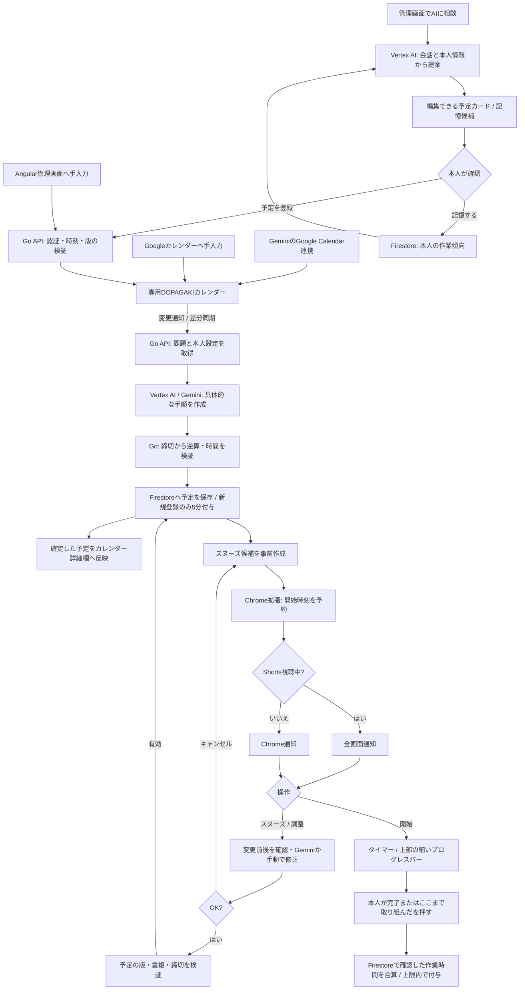

# DOPAGAKI

YouTube Shortsから、いま始める課題へ戻るためのChrome拡張と管理画面です。締切から逆算した作業予定を通知し、取り組んだ時間を記録すると視聴できる時間が増えます。

公開環境：[DOPAGAKI](https://dopagaki-1032251723022.asia-northeast1.run.app/)。Googleログインして使います。Chrome拡張は[Releases](https://github.com/a-sumikawa/devfest-2026/releases/latest)から公開環境向けのZIPを取得できます。[導入手順](extension/INSTALL.txt)に従って読み込んでください。

課題・予定・視聴時間はGoogleアカウントごとに保存します。カレンダー連携もログイン中と同じGoogleアカウントを使い、本人の専用DOPAGAKIカレンダーへ登録します。管理画面の「相談」で会話すると、編集できる予定カードや作業傾向の記憶候補が表示されます。登録・変更・記憶は本人が確認してから確定します。Google Chat連携は廃止しました。[一般ユーザー対応の現状](engineering/public-accounts.md)を参照してください。

実装の仕様は、この会話の確定事項と[指定のSlack投稿]([内部リンク削除])を基にしています。

## 開発記録と発表用の根拠

[engineering/README.md](engineering/README.md) に、設計判断、不具合の症状と原因、運用・CI/CDの現状、実サービス検証、発表用の論点と実画面をまとめています。今後の変更でも、関連する判断・知見・検証結果を併せて更新します。Terraformは未導入です。アプリの変更をmainへマージすると、検証成功後にCloud Runへ[自動配信](engineering/continuous-deployment.md)します。鍵なし認証・候補確認・切替・初回の公開先確認まで成功しています。資料だけ・拡張だけの変更ではCloud Runへの配信を省きます。

## ローカルで試す

ツールのバージョンは [mise.toml](mise.toml) で固定しています。[mise](https://mise.jdx.dev/) を入れてから実行します。

```bash
mise install
pnpm install
pnpm dev
```

[管理画面](http://127.0.0.1:4200)を開きます。初回ログイン時は使い方の案内が1回だけ表示され、URLに `?tutorial=1` を付けるか右上の「使い方」からいつでも見直せます。ローカルデモではGoogle認証や有料APIを使いません。課題のない状態から登録するか、「サンプル3件で試す」を押せます。デモのデータはAPIのメモリー内にあり、APIを停止すると消えます。

Chrome拡張は次のコマンドで作成します。

```bash
pnpm --filter @dopagaki/extension build
```

`chrome://extensions` でデベロッパーモードを有効にし、「パッケージ化されていない拡張機能を読み込む」から `apps/extension/.output/chrome-mv3` を指定します。その後、管理画面を開き直すと同じユーザーのデータに接続されます。拡張IDは manifest の `key`（[`apps/extension/buildconfig/extension-key.ts`](apps/extension/buildconfig/extension-key.ts) の公開鍵）で `egongmmfglcolkgiappacmmbiiiogpmb` に固定しており、どの端末で読み込んでも同じなので、APIの live モードではこのIDを環境変数 `EXTENSION_IDS` に設定します。

拡張のポップアップにある「この作業サイトにタイマーを表示」を押すと、そのサイトだけにタイマーを表示する権限を求めます。最初からすべてのサイトへのアクセスは要求しません。

## Chrome拡張のリリース

`vX.Y.Z` 形式のタグをGitHubへpushすると、[Release extension](.github/workflows/release-extension.yml) がタグのコードを型チェック・単体テストし、公開環境向けにビルドします。拡張のバージョンはタグから設定し、ZIP・導入手順・SHA-256チェックサムをGitHub Releasesへ公開します。各数値は0〜65535、先頭ゼロと `v0.0.0`、ベータ等の接尾辞は使えません。

最新mainを取得した状態で、未使用のバージョンを指定して実行します。

```bash
git tag v0.1.2 && git push origin v0.1.2
```

失敗時はGitHub Actionsの実行結果を確認し、再実行できます。既に公開済みのReleaseは上書きしません。修正は新しいタグで公開してください。ローカルビルドは `apps/extension/package.json` のバージョンを使います。インストール済みの拡張の更新は手動です。

## 管理画面の構成

ホームは日・週のカレンダーです。予定を選ぶと右側に課題カードが開き、「この予定について相談」から対象を付けてAIに相談できます。左メニューはカレンダー・課題・記録、設定とGoogle連携は右上です。狭い画面では予定と相談を切り替え、未送信の文は残します。画面と確認範囲は[開発記録](engineering/calendar-workspace.md)を参照してください。

画面は必要な言葉だけを常時表示します。課題の追加は「＋」、メモ・目的・作業リンクは「＋ 詳細を追加」から開きます。補足説明や使い方も折りたたみ、開閉しても下書きは残します。[画面と確認結果](engineering/simple-ui.md)を参照してください。

## 動作

- 視聴時間は初回10分。当日の補充分を含み、翌日から残高が10分未満なら10分まで補充します。ログインや毎時の追加はありません。
- 新しい課題の登録で5分増えます。同じ課題の再送・編集・再同期では増えず、残高30分を超える分も付与しません。
- 作業後の「ここまで取り組んだ」または完了操作で、一時停止を除いた作業5分につき視聴1分を付与。小さな作業も合算し、作業による追加は1日20分、残高は30分までです。1区間は確定予定の長さと25分の短い方まで数えます。
- 視聴前に5分・10分を選び、区切りで一時停止します。1日の視聴上限は標準30分で、残高とは別に管理します。余った残高は繰り越せます。設定で10分・20分・30分の上限や、固定枠・区切りの通知だけ・自己管理へ変更できます。
- 既存利用者も全員を新ルールへ統一します。適用後の初回アクセス時に残高を一度だけ10分へリセットし、課題・予定は残します。任意切り替えはありません。[実装と検証範囲](engineering/viewing-time-policy.md)を参照してください。
- 「＋」から課題を追加し、「相談／手入力」を選べます。未開始の課題は、課題一覧の編集アイコンまたはカレンダー詳細の「編集」から、変更前後と時間割を確認して編集できます。編集では視聴時間を付与しません。
- 視聴時間は、前面で再生しているYouTube Shortsだけを計測します。通常動画・バックグラウンド・一時停止中は対象外です。
- 通知の時刻は、課題の締切と必要時間から逆算した開始時刻です。通常はChrome通知、Shortsの画面では動画を一時停止して画面全体に表示します。
- スヌーズは初期値10分。候補は通知前に作成し、変更前後の予定を比較できます。時間・順序を手動で変えるか、Geminiに指示し、「OK」で確定します。キャンセルでは変更しません。
- 締切に収まらない場合は、作業時間を短縮した案であることを明示します。1分も確保できない課題や、重複・締切超過は確定できません。
- 課題の開始でタイマーを起動。上端の細いプログレスバー、一時停止・再開、完了ボタンを表示します。タイマーが終わっただけでは報酬を与えません。
- パチンコ・麻雀・シンプルの通知モード、音、動きを控える設定、スヌーズ時間を変更できます。完了履歴は草のカレンダーに反映されます。

Chromeが終了・スリープ中の場合は通知できません。Chrome Alarmsによる通知にはOSやブラウザーの状態に応じた遅延があります。拡張を無効化できるため、強制的な利用制限や不正防止を保証する仕組みではありません。

## 構成

| 部分 | 技術・役割 |
|---|---|
| リポジトリ | pnpm workspaces のモノレポ（`apps/api`・`apps/web`・`apps/extension`・`packages/*`）。設計方針は [AGENTS.md](AGENTS.md) |
| API仕様 | OpenAPI 3.1（`packages/contract/openapi.yaml`）。GoのサーバーとTSのクライアントを生成する |
| 管理画面 | Angular 22（zoneless・signals）、Angular Material / CDK、Material Design 3 のデザイントークン（`packages/tokens`）、WCAG 2.2 AA |
| Chrome拡張 | Manifest V3、WXT、TypeScript、Chrome Alarms / Notifications / Storage |
| API | Go、標準 `net/http`、oapi-codegen、Google公式SDK。機能ごとのパッケージとポート＆アダプター |
| 同期 | 状態が変わると SSE（`/api/events`）で通知し、管理画面と拡張がそのリソースだけを取り直す |
| 外部連携の整合 | Outbox と Cloud Tasks。カレンダーへの反映は再試行つきで非同期に行う |
| AI | Vertex AI / Gemini 3.8 Flash。課題を具体的な手順へ分解し、作業傾向を反映 |
| 認証・永続化 | Firebase Authentication（Googleログイン）、Firestoreのトランザクション |
| Google連携 | Google Calendar API。OAuthの更新トークンはSecret Managerに保存 |
| 配信 | Cloud Runが管理画面とAPIを同じオリジンで配信 |



課題を初めて登録した場合に5分加算します。予定の変更・再同期・スヌーズでは加算しません。作業の傾向や課題のメモは予定作成のためGeminiへ送信します。閲覧中の動画内容や閲覧履歴は送信しません。

カレンダーの利用対象は、連携時に作成する専用の `DOPAGAKI` カレンダーです。他のカレンダーの予定は変更しません。手入力は「開始＝締切−必要時間、終了＝締切」の日時付き予定で登録します。終日・繰り返し予定は対象外です。Geminiでは「DOPAGAKIカレンダーに」と明示します（[Googleの案内](https://support.google.com/gemini/answer/15305236)）。既存メモは保持し、`[DOPAGAKI]` ブロック内に確定予定を記載します。

## Google Cloudで動かすための設定

AIは初期値で1人5回/分・30回/日、全体30回/分・300回/日に制限します。失敗も回数に含み、日次はUTC 00:00（日本時間09:00）に切り替わります。上限時も手入力とCalendar同期は基本の時間割で続けられます。2026-11-07に本番へ反映済みです。[利用上限・CSP・追加監査](engineering/security-hardening-2026-11-07.md)、[本番での確認結果](engineering/security-rollout-2026-11-07.md)を参照してください。

対象プロジェクトは `devfest-2026-513816`（番号 `1032251723022`）です。課金アカウントと予算はユーザー設定済みのものを使います。

1. Firestore NativeデータベースとFirebaseのWebアプリを作成し、AuthenticationのGoogleプロバイダーを有効にします。Cloud Runのドメインを認証の許可ドメインへ追加します。Firestoreのクライアント用ルールは `deploy/firestore.rules` のとおり拒否し、APIのサービスアカウントだけで読み書きします。
2. Calendar API、Secret Manager API、Vertex AI API、Cloud Run / Cloud Build / Artifact Registry APIを有効にします。
3. Web用OAuthクライアントを作成し、リダイレクトURIに `https://<管理画面のオリジン>/api/calendar/callback` を設定します。スコープは `openid`、`email`、`calendar.app.created`。テスト公開中は利用者をテストユーザーへ追加します。
4. `deploy/cloudrun.env.example.yaml` の公開設定を埋め、秘密情報を含まないローカル設定ファイルへ保存します。OAuth client secretはSecret Managerへ登録します。Cloud Tasksのキュー、呼び出し用のサービスアカウント、Cloud Schedulerの更新ジョブ、FirestoreのTTLは `deploy/setup-cloud-tasks.sh` で作ります。`.env`、トークン、鍵はコミットしません。
5. 実行サービスアカウントにFirestore、Vertex AI、カレンダー用Secretの必要な権限を付与します。カレンダー接続時にユーザー別Secretを作るため、`secretmanager.secrets.create`、`secretmanager.versions.add`、`secretmanager.versions.access` を含む権限も必要です。公開設定・権限・イメージを確認してからCloud Runへ配信します。

Cloud Run向けのコンテナーは次で作成できます。

```bash
docker build -t dopagaki .
```

Cloud Runは `min-instances=0`、`max-instances=2`、1 CPU / 512MiB、リクエストタイムアウト60秒を初期値とします。コンテナーは `APP_MODE=live` で動き、必要な設定（プロジェクト・`APP_URL`・Firebaseの設定）が無ければ起動しません。手元で `go run` したときの既定は `demo` です。認証なしで個人データへアクセスできません。環境変数は `.env.example`、公開値の例は `deploy/cloudrun.env.example.yaml` を参照してください。`GOOGLE_OAUTH_CLIENT_SECRET` はSecret Managerから環境変数へ渡します。

Calendarの変更通知チャンネルは6日で期限が切れます。Cloud Schedulerから1日1回 `POST /api/internal/calendar/renew` を、OIDCトークン付きで呼びます（`deploy/setup-cloud-tasks.sh` が作成）。この更新ジョブが無いと継続して同期できません。

管理画面のAI相談は既存のFirebase認証・Vertex AI・Firestoreを使います。新しいGoogle OAuthスコープやChatアプリの配布は不要です。会話履歴は利用者ごとに保存し、拡張には渡しません。カードの登録は既存の課題登録、変更は予定確認画面、記憶は本人の作業傾向へ接続します。[設計と確認範囲](engineering/assistant.md)を参照してください。

公開先が決まったら、そのオリジンに固定して拡張を再ビルドします。

```bash
APP_URL=https://<管理画面のオリジン> pnpm --filter @dopagaki/extension build
```

## 実サービスでの確認

2026年11月7日、main `b3fc7b0`と更新したChrome拡張で[新しい視聴ルールを実YouTube Shortsで確認](engineering/shorts-time-policy-verification-2026-11-07.md)しました。5分の選択、再生中の減算、一時停止中の表示保持、途中終了、管理画面の再読み込み後の記録保持を確認しています。以下の表は以前の確認時点の結果です。

2026年11月6日、架空の確認用課題を使って以下を確認しました。課題・報酬の確認履歴はテスト用です。

| 対象 | 確認した動作 |
|---|---|
| Cloud Run | 東京リージョンで公開。`/api/health` は200、未ログインの `/api/state` は401 |
| Firebase / Firestore | Googleログイン、初回60分、再読み込み後の予定・残高・一時停止タイマーの復元 |
| Vertex AI | Cloud Runの実行アカウントから課題抽出、具体的な手順作成、指示による時間割調整 |
| Google Calendar | 専用カレンダーの作成、Secret Managerへのトークン保存、詳細欄への手順反映、変更通知からの自動取り込みと登録報酬。既存予定の更新では報酬が増えないことも確認 |
| Geminiアプリ | 専用DOPAGAKIカレンダーへの予定作成。その後の自動取り込みと詳細欄への反映も確認 |
| 旧Google Chat | 当時の個人用アプリの検証記録。現在はアプリを無効化し、受付APIを削除 |
| Chrome拡張 | 実際のYouTube Shortsの前面再生で50秒消費。一時停止中は残高が変わらないことを確認 |
| 通知・作業 | 実時刻の全画面通知、事前候補からのスヌーズ確認、手動調整、OK後の保存、上部の作業バー、完了時20分の付与 |
| Cloud Scheduler | 毎日09:00（日本時間）のCalendar監視更新を設定。手動実行も成功 |

カレンダー側の新規予定は、専用Calendar APIからの投入に加え、一般画面での手入力・保存からの自動取り込みも確認しました。[実画面と検証条件](engineering/intake-flow.md)を保存しています。ローカルの拡張E2Eは合成Shorts DOMを使用し、上表の実YouTubeでの確認とは区別しています。

初期確認時のコードは `a25837c`、リビジョンは `dopagaki-00006-btr` です。最新の配信は[運用記録](engineering/operations.md)を参照してください。1 CPU / 512MiB、最小0・最大2インスタンス。Firestoreの直接クライアントアクセスは拒否し、API実行アカウントで読み書きします。課金・予算設定は変更していません。

## 検証

```bash
pnpm generate   # API仕様からGoとTSのコードを生成する（CIでは差分が無いことを確かめる）
pnpm check      # フォーマット・Lint（Go / TS / CSS / API仕様 / コントラスト）・型チェック
pnpm test       # 単体テスト（Go・管理画面・拡張・共有パッケージ）
pnpm build
pnpm --filter @dopagaki/e2e exec playwright install chromium
pnpm test:e2e   # e2e。WCAG 2.2 AA の自動検査（axe）を含む
```

Goのテストでは、視聴時間の台帳から計算した残高とWalletの値が常に一致すること、再送しても報酬が二重に付かないこと（べき等性）、版の不一致の拒否、スヌーズ案の検証、時間の重複、利用者ごとの分離を確かめます。外部サービス（Gemini・Google Calendar・Cloud Tasks）はローカルのHTTP応答で確かめ、有料のAPIは呼びません。Firestoreのテストは、エミュレーター（`FIRESTORE_EMULATOR_HOST`）があるときだけ実行します。Playwrightは画面操作と、パッケージ化していない拡張の接続・計測・通知・タイマーを検証します。

## 提出に向けて

開催条件は添付キックオフPDFの「実行基盤の必須条件」「AI・他社ツールの扱い」「その他のルール」「提出ルール」を参照しています。Cloud Runでの稼働確認、GitHubコード、説明ドキュメント、デモ動画、著作物利用シートを揃える必要があります。11月10日17:00のコードフリーズ後は提出リポジトリを変更せず、デプロイURLは11月14日まで維持します。素材・ライブラリの出典は [ASSETS.md](ASSETS.md) に記録しています。チームの提出操作や共有設定はまだ行っていません。
