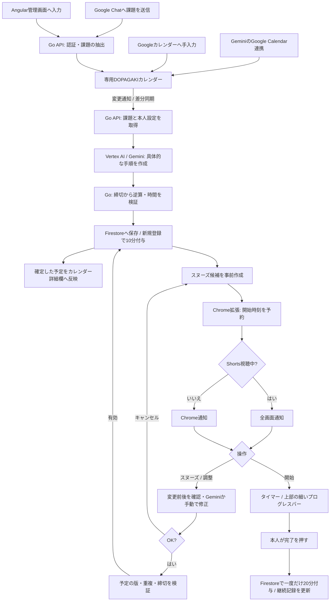

# DOPAGAKI

YouTube Shortsから、いま始める課題へ戻るためのChrome拡張と管理画面です。締切から逆算した作業予定を通知し、完了した分だけ視聴できる時間が増えます。

実装の仕様は、この会話の確定事項と[指定のSlack投稿]([内部リンク削除])を基にしています。`docs/` は別案の資料であり、このアプリの仕様ではありません。

## ローカルで試す

Node.js 24.15以上、Go 1.26以上が必要です。

```bash
npm ci
npm run dev
```

[管理画面](http://127.0.0.1:4200)を開きます。ローカルデモではGoogle認証や有料APIを使いません。課題のない状態から登録するか、「サンプル3件で試す」を押せます。デモのデータはAPIのメモリー内にあり、APIを停止すると消えます。

Chrome拡張は次のコマンドで作成します。

```bash
npm run build:extension
```

`chrome://extensions` でデベロッパーモードを有効にし、「パッケージ化されていない拡張機能を読み込む」から `dist/extension` を指定します。その後、管理画面を開き直すと同じユーザーのデータに接続されます。

拡張のポップアップにある「この作業サイトにタイマーを表示」を押すと、そのサイトだけにタイマーを表示する権限を求めます。最初からすべてのサイトへのアクセスは要求しません。

## 動作

- 視聴時間は初回60分。新しい課題を登録すると10分、完了すると20分加算。繰り越し可能。再送や二重クリックでは増えません。
- 視聴時間は、前面で再生しているYouTube Shortsだけを計測します。通常動画・バックグラウンド・一時停止中は対象外です。
- 通知の時刻は、課題の締切と必要時間から逆算した開始時刻です。通常はChrome通知、Shortsの画面では動画を一時停止して画面全体に表示します。
- スヌーズは初期値10分。候補は通知前に作成し、変更前後の予定を比較できます。時間・順序を手動で変えるか、Geminiに指示し、「OK」で確定します。キャンセルでは変更しません。
- 締切に収まらない場合は、作業時間を短縮した案であることを明示します。1分も確保できない課題や、重複・締切超過は確定できません。
- 課題の開始でタイマーを起動。上端の細いプログレスバー、一時停止・再開、完了ボタンを表示します。タイマーが終わっただけでは報酬を与えません。
- パチンコ・麻雀・シンプルの通知モード、音、動きを控える設定、スヌーズ時間を変更できます。完了履歴は草のカレンダーに反映されます。

Chromeが終了・スリープ中の場合は通知できません。Chrome Alarmsによる通知にはOSやブラウザーの状態に応じた遅延があります。拡張を無効化できるため、強制的な利用制限や不正防止を保証する仕組みではありません。

## 構成

| 部分 | 技術・役割 |
|---|---|
| 管理画面 | Angular 22、Angular Material / CDK、Material Symbols Rounded |
| Chrome拡張 | Manifest V3、TypeScript、Chrome Alarms / Notifications / Storage |
| API | Go、標準 `net/http`、Google公式SDK |
| AI | Vertex AI / Gemini 3.8 Flash。課題を具体的な手順へ分解し、作業傾向を反映 |
| 認証・永続化 | Firebase Authentication（Googleログイン）、Firestoreのトランザクション |
| Google連携 | Google Calendar API、Google Chat。OAuthの更新トークンはSecret Managerに保存 |
| 配信 | Cloud Runが管理画面とAPIを同じオリジンで配信 |



新規課題として初めて登録された場合だけ10分を付与します。予定の変更・同期・スヌーズでは加算しません。作業の傾向や課題のメモは予定作成のためGeminiへ送信します。閲覧中の動画内容や閲覧履歴は送信しません。

カレンダーの利用対象は、連携時に作成する専用の `DOPAGAKI` カレンダーです。他のカレンダーの予定は変更しません。手入力は「開始＝締切−必要時間、終了＝締切」の日時付き予定で登録します。終日・繰り返し予定は対象外です。Geminiでは「DOPAGAKIカレンダーに」と明示します（[Googleの案内](https://support.google.com/gemini/answer/15305236)）。既存メモは保持し、`[DOPAGAKI]` ブロック内に確定予定を記載します。

## Google Cloudで動かすための設定

対象プロジェクトは `devfest-2026-513816`（番号 `1032251723022`）です。課金アカウントと予算はユーザー設定済みのものを使います。

1. Firestore NativeデータベースとFirebaseのWebアプリを作成し、AuthenticationのGoogleプロバイダーを有効にします。Cloud Runのドメインを認証の許可ドメインへ追加します。Firestoreのクライアント用ルールは `deploy/firestore.rules` のとおり拒否し、APIのサービスアカウントだけで読み書きします。
2. Calendar API、Secret Manager API、Vertex AI API、Cloud Run / Cloud Build / Artifact Registry APIを有効にします。
3. Web用OAuthクライアントを作成し、リダイレクトURIに `https://<管理画面のオリジン>/api/calendar/callback` を設定します。スコープは `openid`、`email`、`calendar.app.created`。テスト公開中は利用者をテストユーザーへ追加します。
4. `deploy/cloudrun.env.example.yaml` の公開設定を埋め、秘密情報を含まないローカル設定ファイルへ保存します。OAuth client secretとScheduler secretはSecret Managerへ登録します。`.env`、トークン、鍵はコミットしません。
5. 実行サービスアカウントにFirestore、Vertex AI、カレンダー用Secretの必要な権限を付与します。カレンダー接続時にユーザー別Secretを作るため、`secretmanager.secrets.create`、`secretmanager.versions.add`、`secretmanager.versions.access` を含む権限も必要です。公開設定・権限・イメージを確認してからCloud Runへ配信します。

Cloud Run向けのコンテナーは次で作成できます。

```bash
docker build -t dopagaki .
```

Cloud Runは `min-instances=0`、`max-instances=2`、1 CPU / 512MiB、リクエストタイムアウト60秒を初期値とします。`APP_MODE=live` が標準で、認証なしで個人データへアクセスできません。環境変数は `.env.example`、公開値の例は `deploy/cloudrun.env.example.yaml` を参照してください。`GOOGLE_OAUTH_CLIENT_SECRET` と `SCHEDULER_SECRET` はSecret Managerから環境変数へ渡します。

Calendarの変更通知チャンネルは6日で期限が切れます。Cloud Schedulerから1日1回 `POST /api/calendar/renew` を呼び、`Authorization: Bearer <SCHEDULER_SECRET>` を設定してください。この更新ジョブを設定しないと継続して同期できません。

Google ChatアプリはHTTPエンドポイントを `https://<管理画面>/api/chat`、認証Audienceを `CHAT_AUDIENCE` と一致させます。同じGoogleアカウントでカレンダーを連携した利用者だけ受け付けます。例：「明日18時までにレポート、必要時間60分」。

公開先が決まったら、そのオリジンに固定して拡張を再ビルドします。

```bash
APP_URL=https://<管理画面のオリジン> npm run build:extension
```

Google Cloudへの配信、実アカウントでのOAuth / Calendar / Chat / Vertex AI、Firestoreの実サービスとの結合試験は、この変更時点では未実施です。ローカルデモと合成のShorts DOMを使った拡張試験を、実サービスでの確認と区別してください。

## 検証

```bash
npm run build
npm test
(cd api && go vet ./...)
npx playwright install chromium
npm run test:e2e
```

Goのテストでは、並行再送時の報酬、スヌーズ候補、競合の拒否、時間の重複、他ユーザーとの分離を確認します。Gemini SDKはローカルHTTP応答を使い、本人情報が渡ることと不正な時間割を拒否することを確認します。Playwrightは画面操作と、パッケージ化していない拡張の接続・計測・通知・タイマーを検証します。有料の外部APIは呼びません。

## 提出に向けて

開催条件は添付キックオフPDFの「実行基盤の必須条件」「AI・他社ツールの扱い」「その他のルール」「提出ルール」を参照しています。Cloud Runでの稼働確認、GitHubコード、説明ドキュメント、デモ動画、著作物利用シートを揃える必要があります。11月10日17:00のコードフリーズ後は提出リポジトリを変更せず、デプロイURLは11月14日まで維持します。素材・ライブラリの出典は [ASSETS.md](ASSETS.md) に記録しています。チームの提出操作や共有設定はまだ行っていません。
