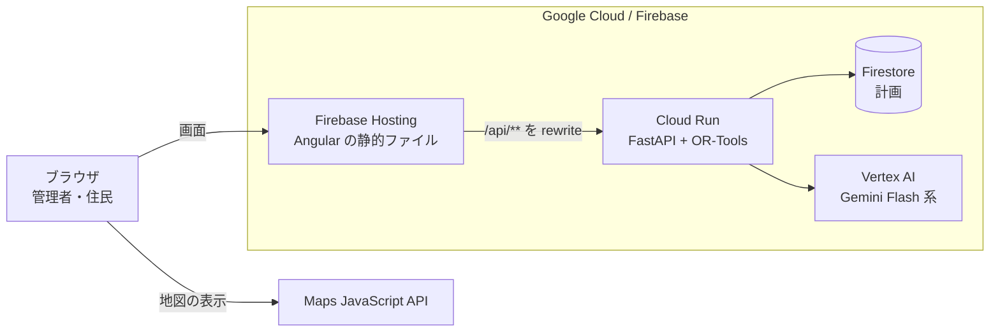

# 避難支援システム 技術設計書

| 項目 | 内容 |
|---|---|
| プロジェクト名 | 未定 |
| 開発チーム | もみじAI |
| 文書名 | 技術設計書 |
| バージョン | 0.2（チーム内レビュー用） |
| 作成日 | 2026年11月5日 |
| 関連文書 | [技術選定の理由](tech-selection.md)、[要件定義書](requirements.md)、[概要](overview.md) |

---

## 1. 技術設計概要

### 1.1 基本方針

避難所の割り当てと配車は数理最適化（OR-Tools）で計算し、言葉を扱う処理だけを Gemini に任せる。

- 割り当てと配車では「収容人数を超えない」「車椅子の人を車椅子に対応していない車に乗せない」といった制約を必ず守る必要がある。数理最適化なら制約を満たした解だけが返り、守られているかをテストで確かめられる。LLM には制約を守る保証も、同じ入力から同じ答えを返す保証もない。
- 一方、介護や医療の配慮情報は「車椅子で、夜間は吸引が必要」のような自由記述で書かれることが多く、ルールでは読み取りきれない。この部分は Gemini に任せる。
- 計画を人に伝える文章も Gemini が書く。ただし数値や割り当ては最適化の結果から変えさせない。

### 1.2 構成の要約

| 層 | 使う技術 |
|---|---|
| 画面 | Angular、Maps JavaScript API（2D） |
| 画面の配信 | Firebase Hosting |
| API | Python、FastAPI、Cloud Run |
| 最適化 | OR-Tools（割り当ては CP-SAT、配車はルーティングライブラリ） |
| AI | Gemini（Flash 系）を Vertex AI 経由で呼ぶ |
| 保存 | 計画は Firestore、入力データと距離行列はリポジトリの JSON |
| 移動時間 | Routes API で距離行列を事前に1回だけ取る |

### 1.3 設計の前提になる制約

ハッカソンのルール（キックオフ資料 `docs/DevFest2026_kickoff_まとめ.pdf`）から、次の制約を受ける。

| 制約 | 設計への影響 |
|---|---|
| 実行基盤は App Engine / Compute Engine / GKE / Cloud Run / Firebase App Hosting / Firebase Hosting のどれか1つ以上 | Firebase Hosting と Cloud Run を使う |
| メインの技術スタックは Google の技術。他社 AI を前面に出すと審査対象外 | 主要な部分を Google の技術でそろえる。LLM は Gemini だけを使う |
| 採点項目「Google 技術が中核で機能しているか」「採用理由を具体的に説明できるか」 | 技術ごとに選定理由と捨てた案を残す（[技術選定の理由](tech-selection.md)） |
| 採点項目「安全性・拡張性・保守性」 | 鍵ファイルを作らない構成にする（6章） |
| クラウドクレジットは1チーム $20。AI Studio には使えず、Gemini は Vertex AI 経由で呼ぶ | 有料 API の呼び出し回数を設計で抑える |
| デプロイ URL を Regional Day（11/14）まで動かし続ける | 待機中に課金されない構成にする |
| オンライン会場は書類とデモ動画で審査。デモ動画の偽装は審査対象外 | デモでも本物の計算と Gemini を呼ぶ。そのうえで結果が安定するようにする |
| 提出締切 11/10 17:00（19:00 の表記もあるが、早いほうで動く） | 開発期間は約5日。作る量を絞る |
| 提出用リポジトリでは GitHub Actions が使えない | CI は開発用リポジトリだけで回す |

---

## 2. 技術スタック

選んだ理由、捨てた案、弱点と対策は [技術選定の理由](tech-selection.md) に書く。

| 層 | 選んだもの | 捨てた案 |
|---|---|---|
| 画面 | Angular | Flutter Web、Next.js、React（Vite） |
| 地図 | Maps JavaScript API（2D） | Photorealistic 3D、deck.gl の重ね描き |
| API | Python と FastAPI | Flask、Functions Framework |
| 最適化 | OR-Tools（CP-SAT とルーティングライブラリ） | Route Optimization API、HiGHS、貪欲法の自作 |
| AI | Gemini（Flash 系）を Vertex AI 経由で | Pro 系、AI Studio 経由、他社 LLM |
| 保存 | 計画は Firestore、入力は JSON | Cloud SQL、入力も Firestore、保存しない |
| 移動時間 | Routes API で事前に1回 | Routes API を毎回、直線距離に係数 |
| 実行基盤 | Firebase Hosting と Cloud Run | Firebase App Hosting、Cloud Run を2つ、Cloud Run を1つ |
| 型の共有 | OpenAPI から TypeScript の型を生成 | 手で書く |
| ログイン | 作らない | Firebase Authentication、匿名ログイン |

---

## 3. システム構成

### 3.1 構成図

提出用のアーキテクチャ図は、Google Cloud 公式のアイコン（cloud.google.com/icons）を使って別に描く。ここではその下書きとして、つながりだけを示す。

距離行列は、開発者の手元のスクリプトから Routes API を1回呼んで作り、JSON としてリポジトリに入れる。デプロイしたシステムからは Routes API を呼ばない。

### 3.2 リクエストの流れ

1. ブラウザが Firebase Hosting から画面を読み込む。
2. 地図はブラウザから Maps JavaScript API を直接呼んで表示する。
3. 画面が `/api/...` を呼ぶと、Firebase Hosting が Cloud Run に転送する。
4. Cloud Run は、リポジトリの JSON（避難者、避難所、距離行列）を読み、OR-Tools で計画を作る。
5. 配慮情報の読み取りと説明文は、Cloud Run から Vertex AI の Gemini を呼んで作る。
6. 作った計画は Cloud Run が Firestore に保存する。画面は Firestore を直接読まず、必ず API 経由で読む。

### 3.3 リージョン

| サービス | リージョン | 状態 |
|---|---|---|
| Cloud Run | asia-northeast1 | 決定（Hosting の rewrite 対応を確認済み） |
| Firestore | 未定 | 未決 |
| Vertex AI（Gemini） | 未定 | 未決（使うモデルの提供リージョンを確かめる） |

---

## 4. AI・最適化設計

### 4.1 役割分担

| 処理 | 担当 | 理由 |
|---|---|---|
| 配慮情報の読み取り（自由記述を決まった項目に） | Gemini | ルールでは書ききれない言い回しを読む必要がある |
| 避難所の割り当て | OR-Tools CP-SAT | 収容人数と配慮の条件を必ず守る必要がある |
| 配車（誰をどの車でどの順に） | OR-Tools ルーティングライブラリ | 車の定員と迎えの順番を扱う専用の道具がある |
| 計画の説明文 | Gemini | 結果を職員や家族が読める文章にする |

### 4.2 Gemini の使い方

**配慮情報の読み取り**

- 入力は、避難者ごとの配慮情報の自由記述。
- 出力は、FastAPI の Pydantic で定義した決まった項目（例：車椅子の要否、医療機器の有無、介助者の人数）の JSON。構造化出力のスキーマとして同じ型を渡し、決まった項目以外を受け付けない。
- 読み取った結果は、最適化の制約の入力になる。

**計画の説明文**

- 入力は、最適化の結果（誰を、どの避難所へ、どの車で、何時に）。
- 出力は、職員向けと家族向けの短い説明文。
- 割り当てや時刻は最適化の結果のまま使い、Gemini に変えさせない。
- 画面では、AI が書いた文章であることを表示する（NFR-010）。

**結果を安定させる**

- temperature を 0 にする。デモ動画を撮り直しても、同じ入力ならほぼ同じ出力になるようにする。

### 4.3 最適化

**避難所の割り当て（CP-SAT）**

- 変数は「避難者 i を避難所 j に割り当てるか」の 0/1。
- 割り当てられない人が出ることを許し、その人を画面に出す（FR-018）。
- 定式化（変数、制約、目的関数）は担当者が別に書き、この節に追記する。
- CP-SAT は整数の係数しか扱えないので、移動時間は秒の整数で持つ。

**配車（ルーティングライブラリ）**

- 割り当ての結果を受けて、自宅で乗せて割り当て先の避難所で降ろす組み合わせとして解く。
- 車ごとの定員（座席数、車椅子の席数）を制約にする。

**時間と再現性**

- 割り当てと配車を合わせた制限時間は、Firebase Hosting のタイムアウト 60 秒より十分短くする。値は未決。
- 同じ入力から同じ計画が出るように設定する。具体的な設定（乱数の種、並列数など）は実装時に公式ドキュメントで確かめる。

---

## 5. 外部サービス連携

| サービス | 用途 | 呼ぶ場所 | 認証 | 料金を抑える方法 |
|---|---|---|---|---|
| Maps JavaScript API | 地図の表示 | ブラウザ | API キー（リファラと API で制限） | 必要な画面でだけ地図を読み込む |
| Routes API | 距離行列 | 開発者の手元のスクリプト | API キー（手元の `.env` だけに置く） | デモ地域の分を1回だけ取る |
| Vertex AI（Gemini） | 配慮情報の読み取り、説明文 | Cloud Run | サービスアカウント | Flash 系を使う |
| Firestore | 計画の保存 | Cloud Run | サービスアカウント | 計画だけを保存する |
| ハザードデータ | 未決 | 未決 | 未決 | 災害の種類が決まってから選ぶ |

### 5.1 データの出典とライセンス

著作物利用シートにそのまま写せるよう、使うデータとライブラリをここに記録する。

| データ・ライブラリ | 出典 | ライセンス | 実データ／サンプル |
|---|---|---|---|
| 避難者 | 自作 | — | サンプル（架空） |
| 避難所 | | | |
| 距離行列 | Routes API | | 実データから作成 |
| ハザード情報 | | | |
| OR-Tools | | | |
| Angular | | | |
| FastAPI | | | |

---

## 6. セキュリティ・非機能要件

### 6.1 セキュリティ

- **秘密情報をデプロイ先に置かない。** Cloud Run から Vertex AI と Firestore にはサービスアカウントで入るので、Cloud Run に API キーも鍵ファイルも置かない。Secret Manager も使わない。
- **Routes API のキーは手元から出さない。** 距離行列を作るスクリプトでだけ使い、`.env`（`.gitignore` 済み）に置く。
- **Maps のキーは制限する。** ブラウザに見えるキーなので、使えるサイト（HTTP リファラ）と使える API を制限する。
- **Firestore は Cloud Run からだけ触る。** セキュリティルールはブラウザからの読み書きをすべて拒否にする。ルールの書き間違いでデータが見える事故を防ぐ。
- **実在の人のデータを使わない。** 避難者はすべて架空にする（要件定義書 11 章）。
- **秘密情報をコミットしない。** キックオフ資料で審査の「安全性」に関わると明記されている。

### 6.2 コスト

- Cloud Run は最小インスタンスを 0 にする。
- Routes API は事前に1回だけ呼ぶ。
- Gemini は Flash 系を使う。
- 予算アラートを設定する。アラートは通知するだけで自動では止まらないので、通知を受けたら手で確かめる。
- 各サービスの無料枠の量は未確認。実装前に公式の料金表で確かめる。

### 6.3 非機能要件への対応

| ID | 要件 | 対応 |
|---|---|---|
| NFR-001 | Webブラウザから利用できる | Angular の Web アプリとして Firebase Hosting で配る |
| NFR-002 | PC・スマートフォンに対応する | 画面の作りで対応する。優先順位は要件定義書の未決事項 |
| NFR-003 | 専門知識がなくても操作を理解できる | 普段使う Google マップの上に表示する |
| NFR-004 | 地図上の情報を直感的に把握できる | 同上 |
| NFR-005 | デモ規模で円滑に動作する | 最適化に制限時間を設け、60 秒以内に返す |
| NFR-006 | 情報不足や処理失敗時に案内を表示する | 割り当てられない人を画面に出す（FR-018） |
| NFR-007 | 個人情報を適切に取り扱う | 架空データだけを使い、Firestore をブラウザから触らせない |
| NFR-008 | 対象地域や機能を拡張できる | 地域ごとの入力を JSON で分け、地域はデータを足して増やす |
| NFR-009 | 高齢者や障がいのある利用者に配慮する | 画面の作りで対応する |
| NFR-010 | 実データ・推定・未確認を区別する | サンプルデータと AI が書いた文章に表示を付ける |

---

## 7. 開発・テスト・デプロイ設計

### 7.1 開発の流れ

- `main` に直接 push しない。ブランチを切って PR を作り、別のメンバーが見てからマージする（README のルール）。
- 11/5 10:00 より前に書いたコードは使わない（キックオフ資料の開発開始前のルール）。

### 7.2 テスト

テストは最適化と API に集中させる。

- **最適化**：小さな入力を手で作り、次を確かめる。
  - 避難所の収容人数を超えない。
  - 車椅子の人を、車椅子に対応していない避難所や車に割り当てない。
  - 割り当てられない人が出たとき、その人が結果に含まれる。
- **API**：Gemini の呼び出しを差し替えて、API が正しい形の結果を返すことを確かめる。テストで Vertex AI を呼ばないので、料金がかからず結果もぶれない。
- 画面の E2E テストは書かない。デモ動画を撮る前に、手で一通り操作して確かめる。
- 使うテストツールは未決（8章）。

### 7.3 CI

- 開発用リポジトリ（private）で、PR ごとに lint とテストを回す。
- 提出用リポジトリでは GitHub Actions が使えないので、CI は置かない。

### 7.4 デプロイ

デプロイは手動で行う。5日間では手動で足り、自動デプロイを鍵なしで設定する時間を開発に回す（`docs/overview.md` の判断）。

- 画面：Angular をビルドし、Firebase Hosting にデプロイする。
- API：Cloud Run（asia-northeast1）にデプロイする。最小インスタンスは 0。
- デプロイした URL は Regional Day（11/14）まで動かし続ける。クレジットの残額と期限を確かめておく。

### 7.5 提出

- 締切は 11/10 17:00 として動く。
- 最終版のファイルだけを提出用リポジトリ（public）へ移す。履歴は移さない。
- 提出物：GitHub リポジトリ、プロダクト説明ドキュメント、デモ入りのプレゼン動画、著作物利用シート、アーキテクチャ図（Google 公式アイコン）。
- [技術選定の理由](tech-selection.md) は、プロダクト説明ドキュメントの「選定理由」に使う。5.1 の表は著作物利用シートに使う。

---

## 8. 未決事項

| 項目 | 内容 |
|---|---|
| 災害の種類 | 水害／地震。ハザードデータの選択（5章）が決まる |
| 割り当ての定式化 | 変数、制約、目的関数（4.3 に追記） |
| 最適化の制限時間 | 60 秒より十分短い値 |
| 配慮情報の項目 | Gemini に返させる JSON の項目（4.2） |
| 配慮情報を読み取るタイミング | 避難者データを読み込んだときに1回か、計画を作るたびか |
| 経路の線をどこで取るか | 地図に描く経路（FR-023）を Routes API からいつ、どこで取るか。Cloud Run に API キーを置かない方針（6.1）と両立させる |
| Firestore と Vertex AI のリージョン | 3.3 |
| デモ用の計画が壊されたときの扱い | ログインを作らないため、誰でも計画を作り直せる（技術選定の理由 10.） |
| OpenAPI から型を生成するツール | 技術選定の理由 9. |
| テストツールと lint | Python 側と Angular 側 |
| 避難所ごとの物資予測 | `docs/overview.md` では柱だが、要件定義書には個人向けの FR-019（推奨）しかない |
