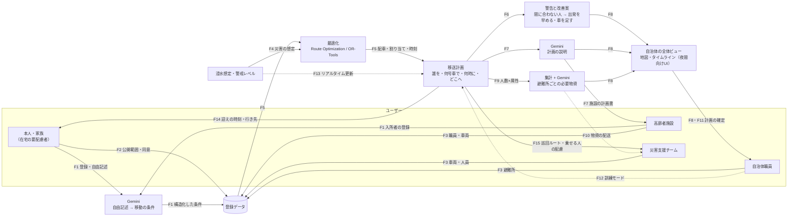

# 概要

## 何を作るか

水害時に自力で避難できない人（要配慮者）の移送を、自治体が **発災前に** 計画し、その結果から避難所ごとの必要物資まで予測する。

- **カテゴリ**：医療・福祉
- **ユーザー（4者）**：
  - 自治体の防災・福祉担当：地域全体を見て計画を確定する（中心）
  - 在宅の要配慮者本人・家族：登録し、自分の迎えの時刻と行き先を確認する
  - 高齢者施設：入所者・職員・車両を登録し、施設の計画を受け取る
  - 災害支援チーム（自治体とは別）：実際に移送を担い、担当の巡回ルートと乗せる人の配慮を受け取る
- **災害**：水害のみ（警戒レベルが出てから避難までの時間の猶予を使って計画する）
- **どんな課題か**：避難計画が「避難所名だけ」で、少ない人手で・誰を・何で・いつ運ぶかが決まっていない。物資は要請が来てから動く
- **既存の取り組みとの違い**：熊本県の災害時物流支援の実証（R8年2月、6市町）は物資が対象で、公開資料に人の移送・要配慮者の記載はない。こちらは人の移送と、人の移動から逆算した物資の需要予測（[出典](https://kumamotodx.jp/case/post-15058/)）

## 全体図

矢印の上の番号は、下の機能一覧（F1〜F13）に対応する。点線は今回は作らない（展望）。

## 機能一覧

| # | 機能 | 中身 | AI・Google 技術 | 区分 |
|---|---|---|---|---|
| F1 | 要配慮者の登録 | 移動手段（独歩・車椅子・寝たきり）、医療的な配慮（酸素・透析など）、介助の必要。自由記述でも入力できる | Gemini：自由記述を条件に変換 | 必須 |
| F2 | 公開範囲と同意 | 本人・家族が、誰にどこまで見せるかを選ぶ（本人のみ／施設／自治体） | — | 必須（在宅を含むため） |
| F3 | 資源の登録 | 施設・災害支援チームの人員と車両（定員・車椅子の枠）、避難所（容量・受け入れ可能な配慮） | — | 必須 |
| F4 | 災害の想定 | 警戒レベル、浸水想定、危険な道 | ハザードデータ、Elevation API | 簡易版のみ |
| F5 | 移送計画の最適化 | 誰を・どの車で・どの順で・何時に・どこへ運ぶか | Route Optimization API／OR-Tools、Routes API | 必須 |
| F6 | 警告と改善案 | 「このままだと3人が間に合わない」→「出発を30分早める／車を1台足す／2階へ垂直避難」 | 計算＋Gemini で説明 | 必須 |
| F7 | 計画の説明と計画書 | 職員向けに理由つきで説明。施設へ計画書として共有 | Gemini | 必須（説明）／できれば（計画書） |
| F8 | 自治体の全体ビュー | 地域全体で、誰がいつどこへ移動するかを地図とタイムラインで見る | Maps | 必須（メイン画面） |
| F9 | 避難所ごとの物資の需要予測 | 割り当ての結果（人数×属性）を集計し、Gemini で必要物資の一覧にする | 集計＋Gemini | 必須 |
| F10 | 物資の配送と配る順番 | 物資をどの順で届けるか | 最適化 | 展望 |
| F11 | 夜間向けの UI | ダークテーマ、大きい文字、少ない操作 | — | できれば |
| F12 | 訓練モード | 平時に計画を試して、訓練に使う | — | 展望 |
| F13 | リアルタイム更新 | 通行止めや浸水の状況を受けて計画を作り直す | — | 展望 |
| F14 | 本人・家族向けの確認 | 自分の迎えの時刻・車両・行き先・持ち物を確認する | Gemini（やさしい言葉で説明） | できれば |
| F15 | 災害支援チーム向けの運行指示 | 担当車両の巡回順、各地点で乗せる人と必要な介助（車椅子・酸素など） | Maps、Gemini | できれば |

## 主な判断とその理由（Own the Why）

| 決めたこと | 捨てた案 | 理由 |
|---|---|---|
| 医療・福祉の「要配慮者の避難計画」にする | 3D 避難ゲーム、医療データ×AI | 誰の課題かが具体的で、実際の被災事例がある。患者の実データを使わずに作れる |
| 人の移送＋物資の需要予測 | 物資の配分だけ | 物資だけでは既存の取り組みと重なる。人の移動が決まれば物資を逆算できる |
| 計画の中心は自治体。本人・家族、施設、災害支援チームもそれぞれ結果を受け取るユーザー | 施設中心、自治体だけが使う | 地域全体の情報を集めて最適化することに価値がある。一方、計画は運ぶ人（支援チーム）と運ばれる人（本人・施設）に届かないと動かない |
| 在宅の要配慮者も含める | 施設の入所者だけ | 在宅の人こそ移送の手段がなく、取り残されやすい。そのかわり公開範囲と同意（F2）が必須になる |
| 水害のみ | 地震、両対応 | 水害は警戒レベルから避難までの猶予があり、「発災前に計画する」が成り立つ。地震は突発的で前提が変わる |
| 物資は集計＋Gemini | 本格的な需要予測モデル | 5日間で作れて、説明もできる。人数×属性の集計で必要量の大枠は出せる |
| 最適化は計算に、解釈と説明は Gemini に | すべて Gemini に任せる | 配車・時刻は計算のほうが正確で検証できる。介護の自由記述の構造化はルールでは書ききれない |
| 開発は private、提出は public に最終版だけ | 提出用で直接開発 | 作業中を公開しない。履歴に秘密情報が残るリスクを避ける |
| CI（PR ごとの lint・テスト）だけ入れ、デプロイは手動 | CD（Cloud Run への自動デプロイ） | 5日間では手動デプロイで足りる。自動デプロイは鍵なし認証の設定に時間がかかり、鍵を使う方法は漏えいリスクがある |

## 未決事項（11/5 夜のミーティングで決める）

- 舞台の地域：熊本県内のどこか／架空の街（当事者性、公開データ、実際の事例との結びつき）
- 最適化の方式：Route Optimization API／OR-Tools／貪欲法
- 実行基盤とフロント・バックエンドの言語：Cloud Run／Firebase

## 提出時の必須記入（採点外）

キックオフ資料より。採点はされないが必須。提出前にまとめて書く。

- AI をどの場面でどう使ったか、なぜその場面か（Google 以外の AI にも触れてよい）
- 開発を通して何を得て、どれだけ成長したか
