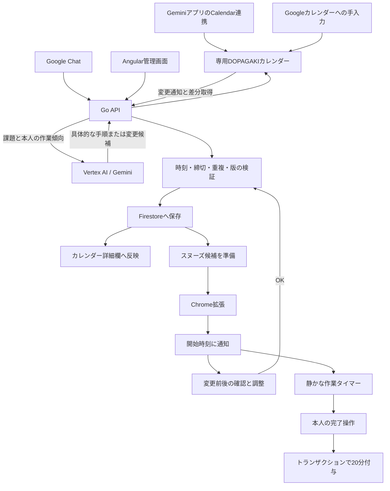

# 構成と設計判断

記録日：2026-11-06。対象コード：`a25837c`。実装の入口は [README](../README.md)。

## 要件の核

YouTube Shortsを見ている利用者が、締切から逆算した開始時刻に課題へ戻れるようにする。予定の具体化と入力はAIで補助し、時間・報酬・保存の整合性は通常のコードで管理する。

| 要件 | 実装上の扱い |
|---|---|
| Gemini、カレンダーへの手入力、Google Chatの3入口 | 専用DOPAGAKIカレンダーとGo APIへ集約。管理画面からの登録も用意 |
| 本人に合わせた具体的な予定 | 本人が管理画面へ入力した作業傾向と課題のメモをGeminiへ渡す |
| カレンダーの詳細欄で確認・管理画面で修正 | 詳細欄の専用ブロックへ手順を書き戻し、管理画面でも確認・調整できる |
| 初回の持ち時間約1時間 | 初期値60分。新規課題の登録で10分、本人が完了を押すと20分 |
| 開始時刻で通知 | 逆算した開始時刻をChrome Alarmsへ登録。Shorts上では全画面通知 |
| スヌーズ初期値10分 | 設定で変更できる。変更後の予定を確認し、OKで確定 |
| その場で手動またはGeminiで調整 | 確認中の候補を編集し、保存前に時刻・重複・版を検証 |
| 派手な通知、静かな作業 | 通知は提供された金色背景。作業中はタイマーと上部の細いバー |
| 既存部品を利用 | Angular Material、Material Symbols、Google公式SDK、Go標準ライブラリを優先 |

「google notebook」と呼ばれていた別の連携は採用していない。既存 `docs/` の別案の機能も取り込まない。

## コンポーネント

| 部分 | 採用技術 | 分担と理由 |
|---|---|---|
| 管理画面 | Angular 22、Angular Material / CDK | 入力、予定確認、本人設定、記録。ダイアログ等の基本部品を自作しない |
| Chrome拡張 | Manifest V3、TypeScript | Shortsの再生条件、通知、作業バー。Webサイト単体では扱えないブラウザーの動作を担当 |
| API | Go、`net/http` | 認証、予定検証、報酬、各Google APIとの通信 |
| AI | Vertex AI、Gemini 3.8 Flash、Google Gen AI Go SDK | 文章からの課題抽出、手順の具体化、指示に応じた候補の変更 |
| 認証 | Firebase Authentication | Googleログイン。APIはFirebase ID tokenを検証 |
| 永続化 | Firestore Native | 利用者ごとの予定・状態。トランザクションで競合を扱う |
| カレンダー | Google Calendar API、OAuth | アプリが作る専用カレンダーの入出力と変更通知 |
| Chat | Google Workspaceアドオン形式のChatアプリ | メッセージから課題を受け付け、登録結果を返す |
| 秘密情報 | Secret Manager | OAuth client secret、ユーザー別OAuthトークン、Scheduler用Secret |
| 配信 | Cloud Run、Artifact Registry、Cloud Build | 管理画面とAPIを同一オリジンで配信。現状の配信操作は手動 |

Cloud RunとFirestoreは東京、Vertex AIの設定は `global`。Cloud Runが東京であることをもって、すべての処理が日本国内で行われると説明しない。

## AIと通常のコードを分ける

[planner.go](../api/internal/app/planner.go) の役割は3つ。

1. `Parse`：入力文から課題名、締切、分数、メモ等を抽出する。不明な締切や必要時間を勝手に作らないよう指示し、空の結果等は入力の具体化を求める。
2. `Detail`：本人の作業傾向を参考に、1〜8段階、各1分以上、合計が指定時間になる具体的な手順を作る。
3. `Adjust`：確認中の候補を、利用者の指示で変更する。

AIから返ったJSONをそのまま確定しない。手順の時間合計、開始終了、締切、課題数・ID、重複等をAPIで検証する。報酬付与や残高計算もAIには任せない。入力中の別命令を扱わない旨はプロンプトに記載しているが、これだけで入力由来の攻撃を完全に防ぐという検証はしていない。

GoogleのGeminiアプリからの入口と、アプリ内部のVertex AI呼び出しは別のもの。前者はGoogleのCalendar連携で予定を作成し、後者はDOPAGAKIのAPIが手順を具体化する。独自のGeminiプラグインを配布したわけではない。

## 予定とスヌーズ

[model.go](../api/internal/app/model.go) で締切から逆算する。カレンダーの日時付き予定は、開始と終了の差を見積もり時間、終了を締切として取り込む。

スヌーズ候補は通知後に毎回AIへ依頼せず、API側で事前に用意する。確認画面では候補のコピーを操作し、OKまで確定予定を変えない。予定用の版番号と候補の `baseRevision` が一致しない場合は、古い候補の保存を拒否する。

現在の候補生成は、必要な場合に対象の作業時間を比率で短縮する方式。これは「少ない時間で同じ課題量を必ず終えられる」という予測ではない。短縮案であることを示し、本人が時間や順番を調整できるようにする。最適な時間配分アルゴリズムを評価したものでもない。

元の見積もり時間と、確認後の割当時間は異なる場合がある。通知、次の課題、作業タイマー、進捗率には確定した予定の時間を使い、一覧では元の見積もりも区別して表示する。

## 報酬と視聴時間

[store.go](../api/internal/app/store.go) と [server.go](../api/internal/app/server.go) が状態を更新する。

- 登録・完了の報酬は、種類と課題IDから識別し、同じ操作の再送では重複して与えない。
- Firestoreでは利用者単位の状態をトランザクション内で読み、検証・更新する。
- 視聴報告にはreceipt IDを付け、再送で二重に減算しないようにする。
- 視聴receiptの記憶件数には上限がある。過去すべての報告に対する無期限の重複防止ではない。
- 課題の時間が経過しただけでは完了報酬を与えない。本人の完了操作が必要。

[content.ts](../extension/src/content.ts) は、ShortsのURL、表示状態、ウインドウのフォーカス、動画の再生状態、通知の表示状態を見て計測する。バックグラウンドで再生しているだけでは対象にしない。

作業時間はタイマーの呼び出し回数で数えず、開始時刻、一時停止時刻、一時停止の累積から復元する。タブの再読み込みやバックグラウンド化で進捗を失いにくくするための設計であり、OSによる停止中にも通知を実行できる仕組みではない。

## カレンダー同期

[calendar.go](../api/internal/app/calendar.go) の扱い。

- OAuthスコープは `openid`、`email`、`calendar.app.created`。アプリが作る専用カレンダーを対象にする。
- 通知を受けたらCalendar APIから差分を取得する。通知本文を予定データとして使わない。
- `syncToken` を保存する。失効した差分トークンは全件取得へ戻す。
- 元のメモを残し、`[DOPAGAKI]`〜`[/DOPAGAKI]` の中だけを手順の書き戻し対象にする。
- 入力のハッシュからこのブロックを除き、自分が詳細欄を書いた変更を新しい入力と誤認しにくくする。
- ETagと `If-Match` で外部変更との競合を扱う。
- 6日間を要求した通知チャンネルを作り、返された有効期限を保存する。Schedulerから毎日更新処理を呼ぶ。
- Google CalendarとFirestoreをまたぐ単一のトランザクションはない。書き戻しに失敗した場合は `pending` と再同期で扱う。

## 境界

他のカレンダー、YouTubeの動画内容や閲覧履歴をAIへ送る設計ではない。Google Chatは、同じGoogleアカウントのカレンダー接続時に保存する対応関係を使って利用者を特定する。

Firestoreのクライアント用ルールは全拒否。管理画面や拡張から直接Firestoreへ書かず、認証したAPI経由で操作する。拡張の認証接続は `chrome.storage.session`、表示用の状態等は `chrome.storage.local` に保存する。

拡張を無効化できるため、利用制限を強制できる製品や不正防止システムとは位置付けていない。習慣の変化や学習効果は未評価。
