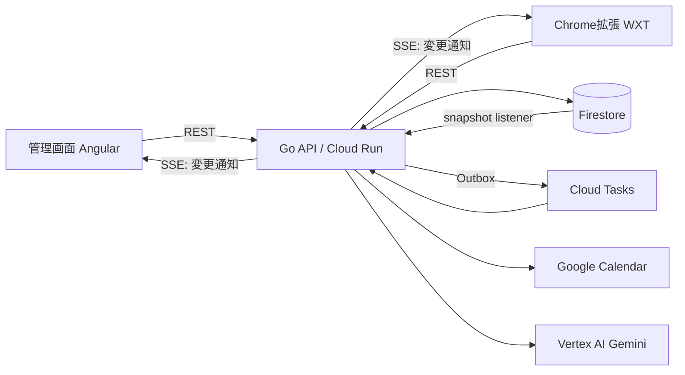

# 構成と設計判断

記録日：2026-11-08。全面的な作り直しに合わせて書き直した。設計の結論と、コードを書くときの決まりごとは [AGENTS.md](../AGENTS.md) にある。ここには、判断の理由と旧実装からの変更を残す。

## 作り直した理由

旧実装は機能としては完成していたが、継ぎ足しで育った構造だった。

| 問題 | 具体例 |
|---|---|
| 1ユーザーの全データが1つの `State` | 課題・台帳・作業・視聴・睡眠などを1ドキュメントに保存。どの更新も同じロックを取り合い、台帳は増え続けて1MBの上限に近づく |
| 層がない | HTTPハンドラーが検証・AI・Calendar・トランザクションを1関数で行う。Calendarに予定を作ってからトランザクションが失敗すると予定だけ残る |
| 型とルールが3重 | GoとTSで手書きの型がずれ、視聴できる残り時間などをサーバー・管理画面・拡張がそれぞれ計算 |
| デザイントークンがない | 16進数の色が160種類、14px未満の文字が約160か所、補足文字のコントラストは3.89:1 |
| 品質を機械的に守る仕組みがない | Linterなし、フォーマットはCIで未確認、CIと本番イメージのGoのバージョンが別 |
| 危ない既定値 | 環境変数なしで起動すると本番のFirestoreへ接続しに行く。視聴の受付記録が2000件を超えると全部消え、再送で二重に減算される |

## 構成

| 判断 | 理由 |
|---|---|
| pnpmのモノレポ | 各アプリが使う依存を自分の `package.json` に書かないと使えない（幽霊依存が起きない） |
| OpenAPIを正とし、GoとTSのコードを生成する | 手書きの型の二重管理をなくす。仕様と実装がずれたらCIで落ちる |
| ルールはサーバーだけが持つ | 表示に必要な値（視聴できる秒数、記録の集計など）はAPIが返す。クライアントの計算は、タイマーを1秒ごとに進める表示だけ |
| 機能ごとのパッケージ＋ポート＆アダプター | 変更の単位とディレクトリの単位が一致する。純粋な `domain` ← `service` ← `adapter` の向きを depguard で強制する |
| 視聴時間は台帳を正とする | 付与・消費・朝の受け取りをすべて追記のみの台帳で表す。残高は台帳から計算した結果で、ずれても作り直せる。台帳のIDがべき等キーになる |
| Outbox＋Cloud Tasks | Google CalendarとFirestoreをまたぐトランザクションは無い。状態とジョブを同じトランザクションで書き、反映は再試行つきで非同期に行う |
| SSEで「変わった」ことだけを送る | データ本体はRESTで取り直すので、API仕様が1つのまま保てる。Firestoreの変更監視を使うので、Cloud Runのインスタンスが複数でも動く |
| Problem Details＋`code` | サーバーは表示用の文言を返さない。文言は `packages/messages` に集約し、管理画面と拡張で共有する |
| `Idempotency-Key` と `If-Match` を全体で統一 | 再送対策を処理ごとの独自方式から1つにまとめ、報酬の二重付与を防ぐ。版の不一致は 412、版の指定が無ければ 428 |
| 1リクエスト＝1トランザクション | 状態の変更と、再送に返す応答を同じトランザクションで確定する。「確定した直後にサーバーが落ちて応答だけ残らない」状態が起きない。AIの呼び出しは最初の書き込みより前に行い、その間はロックを持たない |
| M3トークン | 今の雰囲気（紙のような背景・墨色・青・ライム）を元に、M3の手順でパレットを生成した。役割どおりに使えばWCAG AAのコントラストを満たす |

## 旧実装から変えた振る舞い

本番データは移行せず、リセットする。そのため、旧データの移行処理（`time-policy-reset`、`completion` の報酬など）は削除した。

### 視聴時間

- 視聴の受付記録を上限で消す処理をやめた。べき等性は台帳のドキュメントIDで保証する。
- 日の切り替えに、本人のタイムゾーンを使う（旧実装はアカウント作成時のタイムゾーンで固定していた）。日付が進んだときだけ切り替え、戻らない。
- 視聴した秒数は、実際に残高から減らした秒数と常に一致させる。
- 何も変わらない操作では版を上げない。

### 計画と設定

- スヌーズの長さが変わったときだけ、計画の版を上げる。
- 本人の情報・設定・睡眠・視聴時間のルール・予定の確定は、すべて `If-Match` を必須にした。
- 計画の理由は文章ではなく種類（`backward`、`ai_detailed` など）で返す。組み直しても、AIが具体化した印（`ai_detailed`、`ai_limit_fallback`）は残す。
- 課題名とやる理由は、前後の空白を除いてから長さを検証する。
- 同じIDで課題を作り直すと 409 `task.duplicate`。

### ステータスコード

- 状態と矛盾する操作（視聴の区切りの途中、別の課題を作業中、作業していない、開始済みの課題の編集）は、400 から 409 にした。
- 計画の版の不一致は 409 から 412 にした。

### ショートカット・相棒

- ショートカットの呼び出し回数の制限を「全体 → キーの照合 → 利用者ごと」の順にし、無効なキーで本人の回数を使い切れないようにした。
- 相棒の一言は、AIを使わないとき `line: ""` と `generated: false` を返し、決まった文はクライアントが表示する。iPhoneのショートカットは画面を持たないので、決まった文をサーバーが返す（唯一の例外。`apps/api/internal/shortcut/fallback.go`）。

### Google Calendar

- Googleへの書き込みはすべてOutbox経由にした。
- カレンダーを連携する前でも課題を登録できる。
- すでに消えた予定の削除は成功として扱う。
- 変更通知のチャンネルの更新は、失敗した利用者があっても続け、古いチャンネルを止める。Cloud SchedulerからはOIDCで認証する（共有の秘密の文字列をやめた）。
- 連携し直しても差分取得のトークンを保つ。取り込み中にAIが失敗しても、逆算した計画で続ける。
- 完了した課題は、カレンダーからの取り込みで上書きしない。差分取得のトークンが失効したら、1回だけ全件を取り直す。
- 予定の確定の前に同期しない。予定の詳細欄の `[DOPAGAKI]` ブロックから理由の行を外した。
- 外部での変更を検知したら、ずっと 409 を返すのではなく同期する。

## 本番で未確認のこと

デモモード（メモリーの保存先、AI・カレンダーなし）とe2eで確認した。次は実際のGCPでは未確認。

- Firebase Authentication、Vertex AI、Google Calendar、Cloud Tasks、Secret Manager への実接続（アダプターはローカルのHTTP応答や偽のgRPCサーバーで確認）
- Firestoreはエミュレーターで、実際のストアを通す結合テスト（課題の登録・作業の記録・視聴・朝の精算・再送）まで確認した。本番のFirestoreでは未確認。必要なインデックスとTTLは [deploy/firestore.md](../deploy/firestore.md)
- `deploy/setup-cloud-tasks.sh` の実行（キュー、呼び出し用のサービスアカウント、Cloud Schedulerのジョブ、FirestoreのTTL）
- Secret Managerの古いOAuthトークンのバージョンの削除（実行アカウントに `secretmanager.versions.list` / `destroy` が無い）

## 後回しにしたこと

- インフラのコード化（Terraform）。作り直しの次の別PRで行う。
