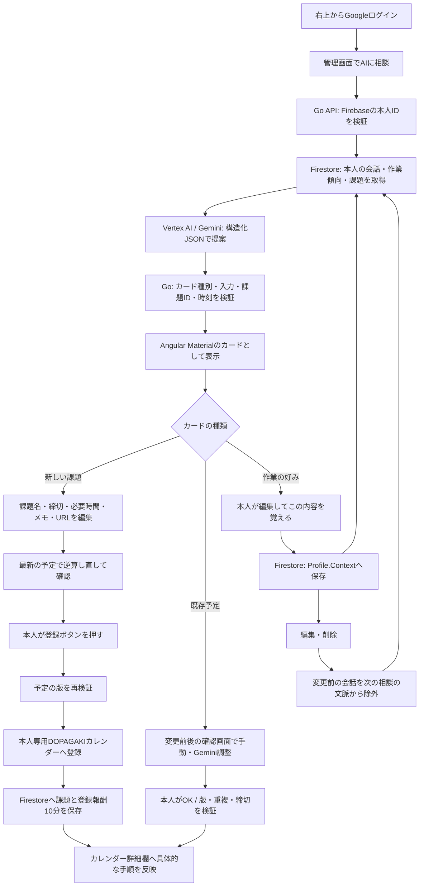
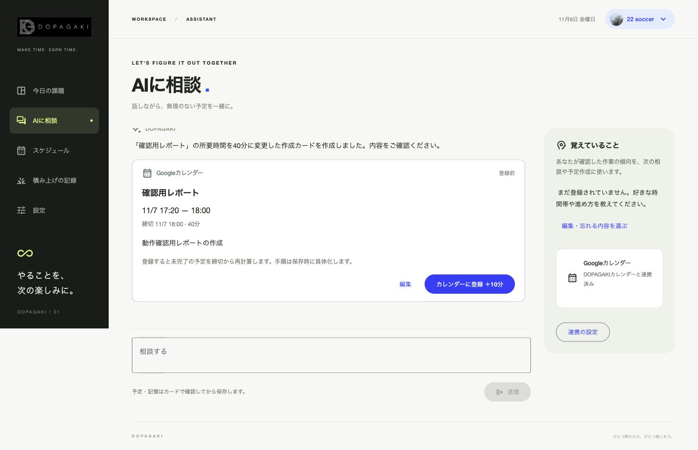

# 管理画面のAI相談

> 2026-11-07の画面改修ではAI相談をカレンダーの右側パネルへ移した。新しい画面・対象を付けた会話は[カレンダー中心の管理画面](calendar-workspace.md)を参照。下記の画像・配信記録は当時の独立した相談画面の記録。

更新日：2026-11-06。ユーザーの指示によりGoogle Chatを廃止し、管理画面の「AIに相談」へ置き換えた。既存のGoogleログインと本人専用のDOPAGAKIカレンダーを使う。

## 操作

1. 左メニューまたは「今日の課題」の「AIに相談」を開く。
2. 締切・必要時間・やることを相談する。足りない情報は会話で確認する。
3. Geminiの返答と、編集できる予定カードが表示される。カードを出した時点では登録も報酬付与もしない。
4. 新規カードでは課題名・締切・必要時間・メモ・URLを編集し、変更内容を確認する。「カレンダーに登録」で初めて登録し、10分を一度だけ付与する。
5. 既存の予定カードは保存済みの最新状態を表示する。「予定・手順を調整」から、従来の変更前後の確認画面で手動またはGeminiによる修正を行い、OKで確定する。
6. 作業の好みは「覚えておくこと」カードで本人が編集・確認して保存する。右側の「覚えていること」から後で編集・削除でき、次の相談と手順作成に使う。

GeminiアプリからのCalendar連携と、Googleカレンダーへの手入力は引き続き利用できる。Google ChatのアプリはCloud Consoleで「無効」を保存済み。旧 `/api/chat` と対応表の新規作成処理を削除した。APIサービスや既存の履歴・旧対応表は削除していない。

## 技術と設計判断

- Angular 22 / Angular Material / CDK、Go `net/http`、Google Gen AI Go SDK、Vertex AI、Firebase Authentication、Firestore、Google Calendar APIを継続利用。追加のnpm依存はない。
- Geminiは `create`（新規予定）、`task`（既存予定）、`memory`（記憶候補）のJSONだけを返す。既定のAngularコンポーネントで描画し、生成HTMLやJavaScriptは実行しない。
- Googleの[A2UIの考え方](https://developers.googleblog.com/introducing-a2ui-an-open-project-for-agent-driven-interfaces/)を参考に、既存Material部品に適した小さなカード形式にした。A2UIプロトコルの互換実装とは位置付けていない。[Geminiの構造化出力](https://ai.google.dev/gemini-api/docs/structured-output)で形式を制約し、最終的な整合性は既存APIで検証する。
- 予定の登録・確定・報酬をLLMへ任せない。カレンダーの権限は既存の `calendar.app.created` のまま。既存カレンダー全体を読み込むスコープの追加はない。

| 実装 | 責務 |
|---|---|
| `api/internal/app/assistant.go` | 本人認証後の会話、GeminiのJSONスキーマと入力検証、書き込まない予定プレビュー、確認済みの記憶追加 |
| `api/internal/app/assistant_store.go` | UID別の会話、Firestoreの処理リース、再送・重複生成の防止 |
| `api/internal/app/server.go` | 既存の課題登録・プロフィール更新・予定確認。カードの版も検証 |
| `web/src/app/assistant.*` | 会話、読み込み、入力保持、履歴の復元、作業傾向の編集 |
| `web/src/app/assistant-card.*` | 3種のカード、編集・確認、既存の予定ダイアログへの接続 |
| `tests/e2e/assistant.spec.ts` | 模擬Gemini応答と実デモAPIで、カードの確認前後・編集・記憶・報酬を検証 |

## 保存・競合・体感速度

会話は `assistantConversations/{uid}/turns/{requestId}` に保存する。拡張へ繰り返し渡す `State` に会話本文を入れない。画面には直近20件を表示し、古い履歴も保存する。Geminiへ渡す会話は直近4件の成功した応答で、本人の作業傾向、現在の未完了課題、現在時刻も含む。

同じUIDではFirestoreのトランザクションで90秒のリースを取得し、同時生成を防ぐ。モデル呼び出しの上限は40秒、結果保存は独立した10秒のコンテキストで行う。切断後に古い処理が新しい処理の結果を上書きしないよう実行IDを確認する。成功済みのrequestIdの再送は保存済みのカードを返し、再度Geminiを呼ばない。失敗した同一依頼は再試行できる。

入力は待機中も残し、応答成功後に送信時と同じ内容であれば消す。読み込みはスケルトン、AI待機はプログレスバーを使う。カードの入力はプレビュー処理中に固定し、確認した内容と送信する内容を一致させる。スヌーズの候補・時間調整は既存の確認画面を再利用する。

新規カードの修正版は同じ課題IDを引き継ぐ。確認前の `planRevision` を確認し、他の予定が変わった場合は再確認する。同じ登録や記憶カードの再送では報酬・記憶を増やさない。削除済みの課題は過去カードから再登録しない。

記憶は既存の `Profile.Context` に保存し、次の手順作成にも使う。本人が編集・削除した時刻を `AssistantContextSince` に記録し、それ以前の会話は新しい相談の文脈から外す。古い会話に残る削除済みの好みを再導入しないため。会話履歴自体の削除とは別であり、画面とプライバシーページにも明記した。生成中に作業傾向が変わった場合は、その返答を確定せず再試行を求める。

## 境界と制約

- 既存予定のカードでは開始・終了・作業手順を編集できる。後続の[登録・内容調整の共通化](task-registration-and-editing.md)で、未開始の課題名・メモ・締切等の変更案と確認保存も追加した。
- 確定した時間割は従来どおりGoogleカレンダーの詳細欄に書く。予定変更でカレンダーのイベント自体の開始・終了を移動する実装ではない。
- Google CalendarとFirestoreにまたがる単一のトランザクションはない。同期失敗は既存のpendingと再同期で扱う。登録済みのCalendarイベントIDと入力ハッシュで重複取り込みを防ぐ。
- 無制限の自動記憶・性格推定ではない。明示された作業上の好みを本人の確認で保存する。記憶候補は500文字、保存した作業傾向全体は2000文字まで。
- 会話の自動期限切れ削除や全履歴の閲覧・削除画面は未実装。サーバー保存情報の削除は公開した窓口で受け付ける。
- Google OAuthの外部公開・テストユーザーなど、Calendar側の配布条件は既存設定に従う。AI相談の実装だけで審査済み・全員の実アカウント検証済みとはしない。

## 検証記録

ローカルのGo回帰テストでは、確認前の無変更、再送時のモデル呼び出しと報酬の重複防止、利用者分離、不正な課題ID、古い版、失敗後の再試行、並行リース、記憶削除後の文脈除外を確認した。Gemini SDKにはローカルHTTP応答を使う。

Playwrightでは、AI待機中の入力保持・二重送信防止、新規カードの編集・取消・登録、記憶候補の編集・保存、既存の予定確認、再読み込み、記憶削除、390px幅でのはみ出し、ブラウザー例外を確認する。課題の確定とプロフィールの保存は実デモAPIを使い、Gemini応答のみ模擬する。

配信コードは `69d0e9d`。Cloud Build `6c83c635-9ffd-464a-a9cc-3e3fd0002312` が成功し、`dopagaki-00012-dh5` へ100%配信した。イメージは `asia-northeast1-docker.pkg.dev/devfest-2026-513816/dopagaki/app@sha256:d82c232fa5eb9c8c60cce190007c381a9f18b4be8bf5afff264c0e72d113b437`。既存の実行・ビルドSA、IAM、Secret、予算は変更せず、Chat専用環境変数だけ取り除いた。

ローカルでは `npm run build`、`npm test`（TypeScript単体4件とGo race）、`cd api && go vet ./...`、`npm run test:e2e`（6件）が成功。公開先ではhealth 200、未認証のassistant 401、旧Chat受付404を確認。

ログイン済みの公開画面から架空課題を相談し、実Geminiが新規予定カードと記憶候補を返した。必要時間を30分から40分へ手動編集すると、開始案が11/7 17:30から17:20へ変わることを確認した。登録・記憶の確定ボタンは押していない。

### 実サービスで見つかったカード生成の失敗

初回の新規カード生成と手動編集は成功したが、追加相談で新規カードの内容検証が失敗した。旧ログは「予定の内容を確認できませんでした」で、入力の欠落とメモ長超過を区別していなかったため、この1回の失敗がどちらだったかは確定できない。予定や記憶は変更されず、入力と同じ依頼IDでの再試行操作が残った。

応答スキーマでは `kind` だけが必須で、種類ごとの必須項目が制約されていなかった。`anyOf` で新規・既存・記憶の3形式を分け、それぞれ `input`、`taskId`、`memory` を必須にした。修正候補でも完全な入力を返す旨をスキーマに明記した。入力欠落とメモ長超過のエラーも分け、個人の相談内容をログへ追加しなくても原因を判別できるようにした。

Googleの[構造化出力の対応フィールド](https://docs.cloud.google.com/gemini-enterprise-agent-platform/models/capabilities/control-generated-output)で `anyOf` と `required` の対応を確認した。既存の未登録候補を40分へ変えても課題IDが維持され、確認前には予定・報酬が変わらない回帰テストを追加。Go raceとvetは成功した。プロンプトで不足項目をお願いするだけでは、種類ごとの構造を十分に制約できないという知見。

### 修正後の公開確認

最終APIコード `7b77026`、Cloud Build `7fdbc9be-205e-4ad6-b69d-e537204fd900`、Cloud Run `dopagaki-00013-vtd`（100%）。イメージは `asia-northeast1-docker.pkg.dev/devfest-2026-513816/dopagaki/app@sha256:df086efcac3269f6ff19a7bc57a72c97c3e7b121313ba3d8a59877cd36992f85`。フロントエンドは最初のAI相談ビルドと同一。

失敗した同じ依頼を画面の「同じ相談を再試行」から再送すると、実Geminiが40分の修正カードを返した。再読み込みしても最初の会話・30分の候補・40分の修正候補が復元された。確定前のため、残高189分、未完了1件、完了4件、作業傾向が空である状態を維持していた。公開環境で確認したのはGeminiとの会話、Firestoreへの履歴保存・復元、未確定カードの手動編集と再計算、失敗後の同一依頼の再試行。新規登録・記憶の確定・予定変更は、今回の公開確認では行わず、前述の実デモAPIと回帰テストで確認した。

機能コミット `69d0e9d` の[GitHub Actions](https://github.com/a-sumikawa/devfest-2026/actions/runs/42234647079)もbuild・test・vet・E2Eすべて成功。後続のスキーマ修正ではGo race/vetを再実行し成功。最終HEADのCI結果はPRのChecksを参照。

## 実画面

架空の課題と作業上の好みを使った公開環境の画面。カレンダー・記憶の確定はしていない。

| 画面 | 証跡 |
|---|---|
| AI待機中、送信内容を保持 | [loading.png](assets/assistant/loading.png) |
| 会話から40分の修正カードを表示 | [calendar-card.png](assets/assistant/calendar-card.png) |
| 課題名・締切・必要時間・メモ・URLを編集 | [edit-card.png](assets/assistant/edit-card.png) |
| 確認してから覚える候補 | [memory-candidate.png](assets/assistant/memory-candidate.png) |
| 失敗時の同じ相談の再試行 | [retry.png](assets/assistant/retry.png) |
| 旧Google Chatアプリの無効化 | [chat-disabled.png](assets/assistant/chat-disabled.png) |

