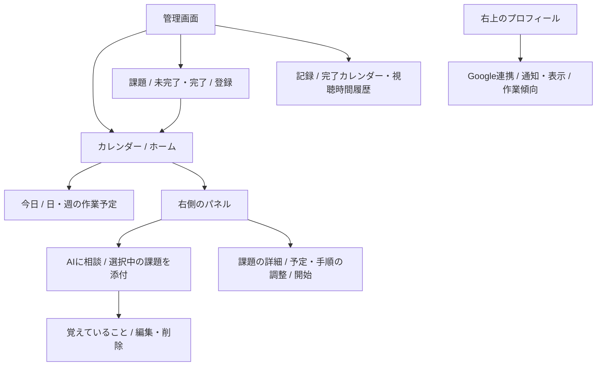

# カレンダー中心の管理画面

実装・確認日：2026-11-07。ユーザーが画面構成の③を選んだため、カレンダーをホームとし、右側にAI相談と課題詳細を置いた。CD整備のPR #6とは別のブランチで実装している。この文書の新UIはローカルで確認したもので、公開環境への反映はまだ行っていない。

## 画面のツリー



左メニューは「カレンダー・課題・記録」の3つ。「今日」と「スケジュール」を統合し、従来のAI相談ページはカレンダーの横へ移した。次の課題の確認・開始と視聴できる時間もホーム上部に残す。作業開始後の静かな上部タイマーと進捗バー、通知とスヌーズの確認は従来の処理を使う。

スマホ・狭い画面ではカレンダーと「相談・詳細」を切り替える。切替時にコンポーネントを作り直さず、未送信の相談文・待機中の応答・カードの編集を残す。広い画面では予定とパネルを同時に表示する。

## 採用部品と責務

- Angular Router 22.2.4で `/calendar`、`/tasks`、`/records`、`/settings` を扱う。再読み込み・戻る・直接リンクに対応する。
- 日・週の時間割は[FullCalendarの公式Angularコネクター](https://fullcalendar.io/docs/angular) 7.1.4。Angular 22対応、標準機能はMIT。Google製ではない。時間軸・イベント配置・現在時刻・キーボード操作を自作しない。
- ボタン、表示切替、フォーム、確認ダイアログはAngular Material。アイコンは既存Material Symbolsのサブセットへchevron_leftを追加した。
- FullCalendarでは予定をクリックしてカードを開く。直接ドラッグして保存する機能は有効にしていない。時間変更は既存の変更前後の確認画面で行う。

| ファイル | 役割 |
|---|---|
| `app.ts/html` | ログイン状態、ナビゲーション、共通タイマー、通知の枠 |
| `routes.ts` | 4ページのURL |
| `calendar-workspace.ts/html/scss` | 日・週の表示、課題選択、相談・詳細パネル、狭い画面の切替 |
| `tasks.ts/html` | 未完了・完了の課題一覧と登録、カレンダーへのリンク |
| `records.ts/html` | 完了と視聴時間の既存記録を表示 |
| `settings.ts/html` | 既存の通知・連携・プロフィール設定 |
| `task-actions.ts` | 画面をまたいで使う登録・開始・完了・予定確認・Google連携の処理 |
| `assistant.ts/html/scss` | 選択した課題を付けた相談と既存の会話・記憶カード |

大きなAppテンプレートからページごとの責務を分けた。登録報酬や予定の検証を画面ごとに実装し直さず、APIと既存の確認ダイアログを使う。

## 選択した課題と会話

カレンダーや課題一覧で選んだ課題は、`task` クエリと相談欄の「相談する予定」に表示する。相談送信時には本文とは別に `taskId` を送る。タイトルが同じ課題でもIDで区別する。

サーバーはそのFirebaseユーザーの状態から課題を引き、Geminiへ `selectedTask` として渡す。他ユーザーのIDや削除済みの課題はモデルを呼ぶ前に拒否する。課題IDは会話履歴にも保存し、再試行は元の相談対象を使う。同じrequestIdを別の課題へ使い回すと409で拒否する。

選択対象を変えたり、パネルを切り替えたりしても、送信中の依頼の対象は変えない。予定・記憶は従来どおり確認操作まで変更しない。Firestoreの新しいコレクションやOAuthスコープ・IAM権限は追加していない。既存の会話で `taskId` がないものも読み込める。

## 日付・リンク・表示

- カレンダーの日・週と表示日を `view`、`date` クエリへ保存する。課題一覧から日付へ移動するときはUTC文字列の先頭を切らず、表示する端末の日付へ変換する。
- 表示時刻は既存UIに合わせて端末のタイムゾーンを使い、カレンダー下部へタイムゾーン名を表示する。プロフィールのタイムゾーンは引き続きAIの予定解釈に使う。
- 拡張が開く `/?notification=...` と `/?snooze=...` を維持し、APIの読み込み後に対象の確認画面を開く。
- 登録・調整した時間割は従来どおり専用Googleカレンダーの詳細欄へ反映する。Googleのイベント自体の開始・終了を移動する実装へ変えたものではない。他の個人カレンダーは読み込まない。

## 実装時の知見

旧スケジュール画面を統合すると手動同期の入口が抜けるため、カレンダー下部へ「Googleと同期」を残した。未連携・デモでは状態の再読み込みを行い、連携済みでは既存のCalendar同期APIを呼ぶ。失敗時にも表示中の予定を消さない。

FullCalendar 7では6系の `slotLabelFormat` が `slotHeaderFormat` になっているため、インストール済みの型と公式移行ガイドに合わせた。イベントのCSSクラスも7系の `className` を使う。

Angularパッケージ7.1.4では個別localeのexport先に日本語ファイルが同梱されておらず、`@fullcalendar/angular/locales/ja` はビルドできなかった。同梱された基盤パッケージの公開export `fullcalendar/locales/ja` を使い、日本語の定義を書き直さず解決した。importの箇所にはこの理由をコメントで残した。

時間枠の短い課題でも名前を確認できるよう、イベントは時刻だけでなく課題名を描画する。Materialの切替部品はアクセシビリティ上radioとして提供されるため、テストもbuttonではなくradioとして操作する。

## 検証

```bash
npm run build
npm test
(cd api && go vet ./...)
npm run test:e2e
```

ローカルで本番ビルド、型確認、既存TypeScript単体4件、Go race/vet、E2E9件が成功した。E2Eは、従来の登録・スヌーズ・報酬・タイマー・拡張に加え、次を確認する。

- 同名課題から選んだ課題IDが相談リクエストに入る。
- 相談しただけでは予定の版と残高が変わらない。
- パネル切替で未送信の文が消えない。
- 日表示、選択した課題、表示日が再読み込みと戻る操作で復元される。
- Asia/Tokyoで深夜の課題が正しい日付へ移動する。
- 390px幅で表示がはみ出さず、予定と相談を切り替えても文が残る。
- 通知とスヌーズの既存URLが引き続き開く。
- カレンダー連携済みなら手動同期をPOSTし、処理中に二重送信せず、失敗しても既存予定と残高を保持する。

Goの追加回帰テストでは同名課題の選択、会話の対象ID保存、再送の重複生成防止、異なる対象へのrequestId再利用の拒否、他ユーザーの課題をGeminiへ送らないことを確認した。モデル応答はローカルHTTPの模擬応答を使い、有料APIは呼んでいない。

実ブラウザーでも架空のサンプルを使って、週の予定クリック→課題詳細→対象を付けた相談、スマホの日表示と入力の保持を確認した。保存した証跡は同じ画面のPlaywright Chromiumによる再現可能な画像を使う。Gemini応答は模擬で、個人の予定や記憶は変更していない。

| 画面 | 証跡 |
|---|---|
| カレンダーと選択した課題カード | [desktop-detail.png](assets/calendar-workspace/desktop-detail.png) |
| カレンダーを見ながら対象付きで相談 | [desktop-consultation.png](assets/calendar-workspace/desktop-consultation.png) |
| スマホの日表示 | [mobile-calendar.png](assets/calendar-workspace/mobile-calendar.png) |
| スマホの相談と入力保持 | [mobile-consultation.png](assets/calendar-workspace/mobile-consultation.png) |

2026-11-07にPR #7をマージし、mainのCIも成功した。Cloud Runへの配信、本人の実Chromeでのカレンダー表示と残高の再読み込み、実Shortsの計測は[配信と実Shortsの記録](shorts-verification-2026-11-07.md)を参照。新しいAI内容編集・Google反映の本番再確認は未実施。CD用PR #6は未マージである。
