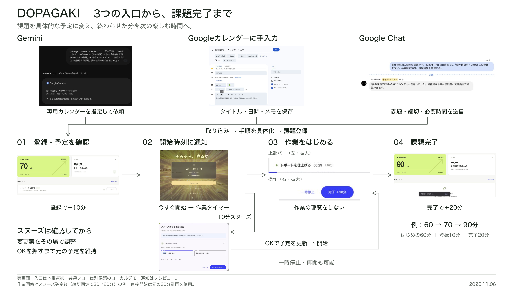

# 発表用：3つの入口から課題完了まで

> Google Chat連携当時の記録を含む旧版です。現在は管理画面のAI相談へ移行しました。現行仕様と確認結果は[管理画面のAI相談](assistant.md)を参照してください。

- [PNG：3840×2160、16:9](assets/complete-flow.png)：Google SlidesやPowerPointへ画像として貼る。スライド全体に合わせれば縦横比を変えずに使える。
- [SVG：1920×1080](assets/complete-flow.svg)：写真を内部に含む1ファイル。拡大や文字・配置の調整用。日本語フォントはHiragino Sans / Noto Sans CJK JPを指定している。
- [出典・条件](complete-flow.json)：写真8枚の元ファイルと出力条件。

## 図の読み方

上段のGemini、Googleカレンダーへの手入力、Google Chatから、共通の課題登録へ合流する。下段は左から、登録・予定確認、開始通知、作業、完了。通知から直接開始する経路と、スヌーズの変更案を確認してOK後に開始する経路を分けた。

登録で＋10分、完了で＋20分。作業中のタイマー・進捗バーと、一時停止・完了の操作は、同じ実画面の上部の左右を拡大して載せている。製品の画面を描き直したものではない。

## 発表での説明例

> 課題はGemini、Googleカレンダーへの手入力、Google Chatのどこからでも登録できます。DOPAGAKIが具体的な予定にして、登録で10分の視聴時間を付与します。始める時刻には通知し、すぐ始めるか、変更後の予定を確認してスヌーズします。作業中は静かなタイマーに切り替わり、完了するとさらに20分を受け取れます。

## 写真の条件

入口の3枚はGoogle実サービス、登録後は同じ架空課題を使ったローカルデモから採用した。複数の撮影例を1つの機能フローとして構成しており、全写真が一つの本番課題を連続実行した記録ではない。図の脚注にも記載した。

通知写真は管理画面のプレビュー。作業写真はスヌーズを確定して30分から20分へ短縮した後。通知から直接開始する場合は元の30分計画を使う。締切固定の短縮案なので、元の30分の作業量を20分で確実に終えられると示す例ではない。

画面の元画像と詳しい操作・検証条件は[入口の記録](intake-flow.md)と[登録後の記録](screen-flow.md#登録後の操作)にある。既存の元画像は変更せず、SVGのクリップと拡大縮小で必要な範囲を配置した。埋め込んだ画像のバイト列が元画像と一致すること、PNG寸法が3840×2160であること、外部画像参照がないことを確認した。日本語と矢印、写真の切り取り範囲、文字の重なりは出力PNGを開いて確認した。

作成日：2026-11-06。図の書き出しのみで、アプリのコード、クラウド設定、予定や報酬のデータは変更していない。
