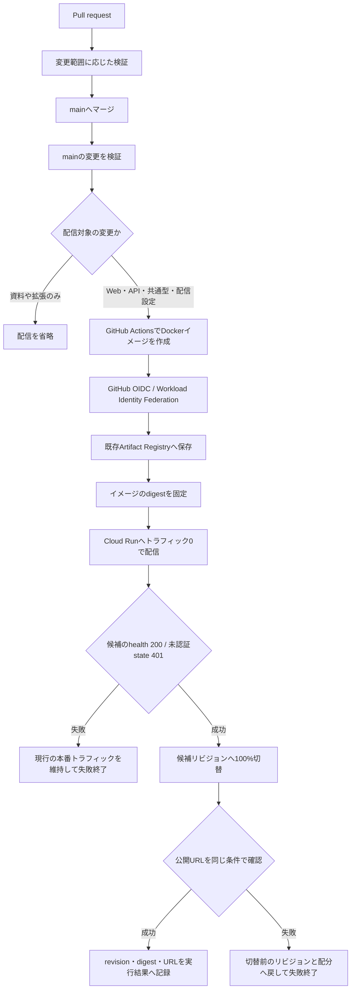

# Cloud Runの継続的デプロイ

設定日：2026-11-07。対象は `a-sumikawa/devfest-2026` と、Google Cloudプロジェクト `devfest-2026-513816`（番号 `1032251723022`）の既存サービス `dopagaki`。Terraformは追加していない。

## 配信の流れ



[check.yml](../.github/workflows/check.yml) の `deploy` は、同じ実行の `check` が成功し、イベントがmainへのpushで、配信対象のファイルが変わったときだけ動く。PRでは配信もOIDC認証も行わない。資料だけ・拡張だけの変更は配信しない。`shared/` が変わればWebにも影響するため配信対象。

mainの実行は直列にし、実行中の配信を新しいpushで打ち切らない。PRの古い検証は従来どおり取り消す。mainの待機枠はGitHub Actionsのconcurrencyに従い最新1件へ置き換わり、中間の全コミットを必ず配信する方式ではない。

## 認証と権限

サービスアカウントのJSON鍵は作らず、GitHub SecretsにもGoogleの鍵を置かない。公式の[auth Action](https://github.com/google-github-actions/auth)と[Workload Identity Federation](https://docs.cloud.google.com/iam/docs/workload-identity-federation-with-deployment-pipelines)を使う。

| リソース | 設定 |
|---|---|
| Pool | `projects/1032251723022/locations/global/workloadIdentityPools/dopagaki-github` |
| Provider | 同Poolの `providers/github`、issuerは `https://token.actions.githubusercontent.com` |
| 配信SA | `dopagaki-deploy@devfest-2026-513816.iam.gserviceaccount.com` |
| Artifact Registryの `dopagaki` リポジトリ | 配信SAへ `roles/artifactregistry.writer` |
| Cloud Runの `dopagaki` サービス | 配信SAへ `roles/run.developer` |
| 実行SA `dopagaki-runtime` | 配信SAへ `roles/iam.serviceAccountUser` |
| 配信SAの偽装 | 当該Pool内のrepository_id `1446515147` だけに `roles/iam.workloadIdentityUser` |

Providerは次をすべて満たすトークンだけ受け付ける。

```text
repository_id       = 1446515147
repository_owner_id = 281961570
ref                 = refs/heads/main
workflow_ref        = a-sumikawa/devfest-2026/.github/workflows/check.yml@refs/heads/main
event_name          = push
```

名前の再利用やfork、PR、別ブランチ、別ワークフローからの配信SA利用を防ぐため、数値のリポジトリ・所有者IDとmainのワークフローを併せて制限した。ワークフローの移動・リポジトリ移管・所有者変更時は、この条件も見直す。mainの書き込み権限を持つ人は、最終的に実行SAの権限で動くコードを配信できる。配信SA自体へFirestoreやSecret Managerの直接アクセス権を付けていないことを、アプリコードからの間接アクセスまで防いでいるという意味には使わない。

Googleの[Cloud Run配信の権限](https://docs.cloud.google.com/run/docs/deploying)に従い、Cloud Run・Artifact Registry・実行SAの各リソースに限定した。IAM管理・他サービスへの配信・予算変更は配信ワークフローの権限に含めない。既存のallUsers Invokerと、Firebaseによる個人API認証は維持する。

配信コマンドは各リソースの `--project` を必ず指定する。クォータプロジェクトを明示する `--billing-project` は配信SAのコマンドへ付けず、[サービスアカウントの所属プロジェクトを使う標準動作](https://docs.cloud.google.com/docs/quotas/set-quota-project)に従う。明示指定のためだけにプロジェクト全体の `serviceusage.services.use` 権限を追加しない。

初回設定のコマンドは [setup-cd.sh](../deploy/setup-cd.sh)。API有効化、SA・Pool・Providerの作成、限定した4つの権限追加を順に行う。これは一度だけ実行するセットアップで、既存リソースの削除・上書きや、完全なIaCの代わりにはしない。再設定時は現在の状態を確認し、必要なコマンドだけ実行する。

## ビルドと切替

- 検証したmainのコミットをチェックアウトし、リポジトリのDockerfileから `linux/amd64` イメージを作る。ローカルの既存Goバイナリーは使わない。
- 長いDockerビルドで短期認証の時間を使い切らないよう、Google認証はビルド後に行う。公式Google Actionsは取得したコミットSHAへ固定した。
- コミットSHAをイメージのタグに使い、実際のCloud Run更新は `@sha256:...` のdigestへ固定する。
- [cloud-run.sh](../deploy/cloud-run.sh) が現行トラフィックを控え、候補を `--no-traffic --tag=cd-candidate` で作る。個人データの認証が外れていないことも確認してから切り替える。
- 切替後に公開URLの確認が失敗した場合、切替前のリビジョンと配分へ戻す。データの変更を巻き戻すものではない。将来のデータ形式変更は、旧版でも読める形で設計する必要がある。
- 候補確認で失敗したリビジョン・タグは調査用に残り、次の実行で候補タグを置き換える。本番配信割合は変えない。
- 変更するのは配信イメージ・リビジョン・タグ・トラフィック。既存のOAuth設定、Secret参照、実行SA、リソース上限、予算設定はスクリプトから変更しない。

ヘルスチェックと未認証拒否は自動で確認する。Geminiへの有料呼び出し、本人のGoogle同意、個人カレンダーの登録、実際のYouTube操作までをCDのたびに行うものではない。API・画面・拡張の回帰確認は、配信前のCIで模擬データを使って行う。

## 停止と手動ロールバック

緊急停止は、配信が始まる前ならGitHub Actionsの対象実行を取り消す。配信済みなら下記で既知のリビジョンへ戻す。配信処理が進行中の場合は状態を確認してから操作する。

```bash
gcloud run services update-traffic dopagaki \
  --to-revisions=KNOWN_GOOD_REVISION=100 \
  --region=asia-northeast1 --project=devfest-2026-513816
```

CDを継続停止する場合はProvider `github` を無効にして新規認証を止め、修正PRを用意する。既に発行された短期トークンの失効と同じ操作ではないため、進行中の実行も確認する。JSON鍵の作成で迂回しない。

## 検証記録

- ローカルの `tests/deploy.test.ts` 6件が成功。候補のhealthまたは認証確認で失敗すると切替がないこと、切替後の確認失敗では元の60%/40%配分まで戻すこと、可変タグの入力を拒否することを確認。外部クラウドや個人データにはアクセスしない。
- `npm run test:unit` は最新mainの拡張ビルド確認を含む11件が成功。`actionlint` v1.7.12、`bash -n deploy/cloud-run.sh deploy/setup-cd.sh`、`git diff --check` も成功。
- GCPでSTS APIの有効化、配信SA・Pool・Providerの作成、対象リソースへの限定した権限追加は完了。
- PR上ではDockerイメージのビルドまで検証し、配信は行わない。mainへの反映とGitHub発の初回CDは、実施後に結果を追記する。


## 最新mainへの統合（2026-11-07）

本番のセキュリティ修正を含むPR #11と、拡張のRelease設定を含むPR #12がmainへ入ったため、既存のCD用PR #6へ最新main `2be9301` を取り込んだ。アプリとDockerfileは最新mainの内容を使う。既存のOIDC Providerと配信SAの権限を読み取り、有効な状態と当該リポジトリ・main・指定ワークフローへの制限を確認した。セットアップスクリプトの再実行や鍵の作成は行っていない。

初回のGitHub発配信は、この更新をmainへ入れた後の実行で確認する。
