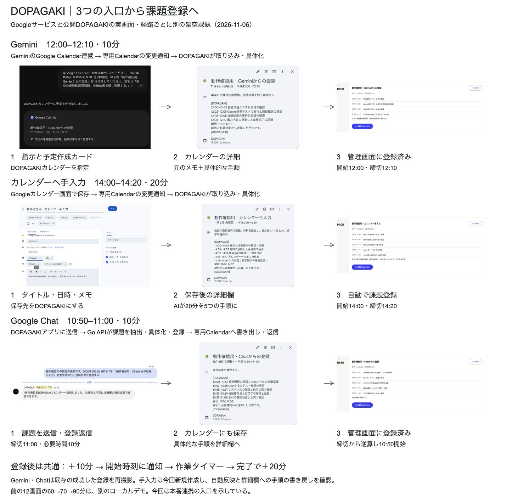

# 3つの入口から課題登録まで

> Google Chat連携当時の記録を含む旧版です。現在は管理画面のAI相談へ移行しました。現行仕様と確認結果は[管理画面のAI相談](assistant.md)を参照してください。

2026-11-06、Google Gemini・Google Calendar・Google Chatと公開DOPAGAKIで撮影。各行は別の架空課題であり、同じ課題を3回登録した図ではない。画像は実画面の必要な範囲を撮影し、内容を描き直していない。

各行を左から右へ読む。中央のカレンダー詳細と右の管理画面は、同じ保存済み予定を表示したもの。写真の順番は、FirestoreとCalendarが直列に一括更新されるという意味ではない。

## Geminiから

GeminiのGoogle Calendar連携で「DOPAGAKIカレンダー」を明示し、タイトル・日時・メモを伝える。Geminiが専用カレンダーへ予定を作成すると、DOPAGAKIが変更を取り込み、内部のVertex AIで作業手順を具体化する。手順はカレンダー詳細欄と管理画面の両方で確認できる。

例は「動作確認用・Geminiからの登録」、12:00–12:10。以前の実サービス確認で作成した予定と会話を開き直して撮影した。今回はGeminiに再送していない。独自のGeminiプラグインを配布したものではなく、Geminiの既存Calendar連携を使っている。

## カレンダーへの手入力から

Googleカレンダーの「作成」→「予定」で、タイトル、開始・終了、説明を入力する。保存先を専用の「DOPAGAKI」にして保存する。日時付き予定の長さを必要時間、終了を締切として取り込み、手順を具体化する。

今回は「動作確認用・カレンダー手入力」を14:00–14:20で実際に作成した。「今すぐ同期」を押さずに、管理画面への反映と詳細欄への書き戻しを確認した。記録画面には09:20の登録報酬＋10分が1件増えていた。前の検証ではAPIからの予定作成だったが、今回はGoogle Calendarの一般画面の入力・保存も通した。

生成結果は20分を5つの手順に分けた。実出力には「カレンダーへの手入力作業」も含まれる。資料の要約だけを行う課題としては修正の余地があり、画面はその実出力を保持している。手順の具体化と同期が動いたことを示す例で、内容の完全性を証明する例ではない。

## Google Chatから

個人用のDOPAGAKIアプリへ、課題名・締切・必要時間・メモを送る。Go APIが文章から課題を抽出し、手順の具体化と登録、専用カレンダーへの保存を行い、登録結果を返信する。Geminiの入口と異なり、ChatメッセージはDOPAGAKIのAPIが直接受け取る。

例は「動作確認用・Chatからの登録」、締切11:00、必要時間10分。開始10:50の計画を確認した。以前の成功した送信・返信を開き直して撮影し、今回は新しいメッセージを送っていない。

## 元画像

| 入口 | 入力と結果 | カレンダー詳細 | 管理画面の課題 |
|---|---|---|---|
| Gemini | [指示・作成カード](assets/intake-flow/gemini-request-result.jpg) | [詳細欄](assets/intake-flow/gemini-calendar-detail.jpg) | [12:00開始の課題](assets/intake-flow/gemini-registered.jpg) |
| 手入力 | [保存前のフォーム](assets/intake-flow/calendar-manual-input.jpg) | [保存後の詳細欄](assets/intake-flow/calendar-manual-detail.jpg) | [14:00開始の課題](assets/intake-flow/calendar-manual-registered.jpg) |
| Google Chat | [送信・登録返信](assets/intake-flow/chat-request-result.jpg) | [詳細欄](assets/intake-flow/chat-calendar-detail.jpg) | [10:50開始の課題](assets/intake-flow/chat-registered.jpg) |

画像寸法、課題名、経路、再撮影と新規操作の区別は [intake-flow.json](intake-flow.json) に保存した。アカウント操作部、関係のないチャットやノートブックを図に含めていない。

対話表示は736pxの明色と360pxの暗色で画像読み込み、6本の矢印、画像選択による拡大、横はみ出しがないことを確認した。製品コード・クラウド設定の変更や再配信は行っていない。

## 登録後

登録で＋10分を受け取り、開始時刻の通知、スヌーズ確認、作業タイマー、完了時の＋20分へ進む。続きは[12画面の操作フロー](screen-flow.md#登録後の操作)を参照。

このページは本番連携の例。続きの12画面は「レポートを仕上げる」を使うローカルデモで、60→70→90分の残高は別セッションのもの。両者を同じ課題・残高の連続した実行記録として説明しない。
