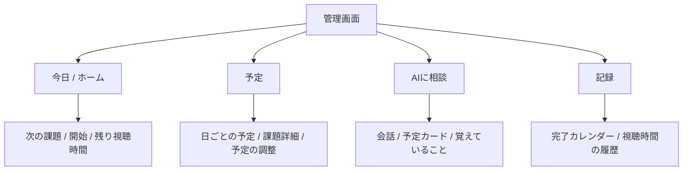
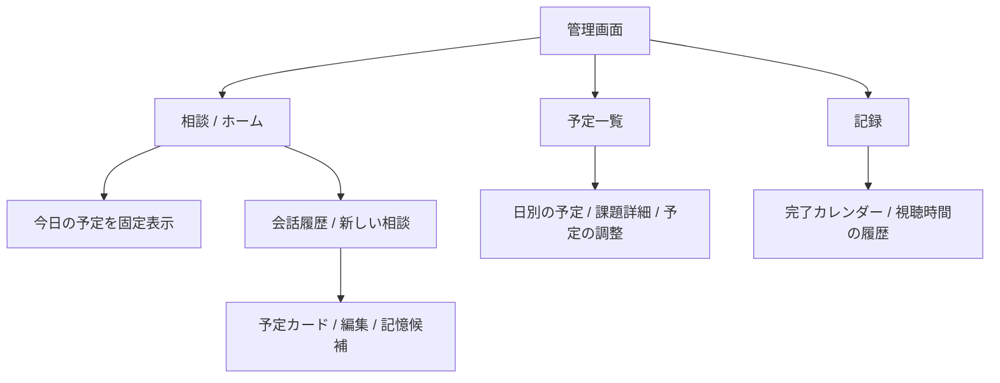
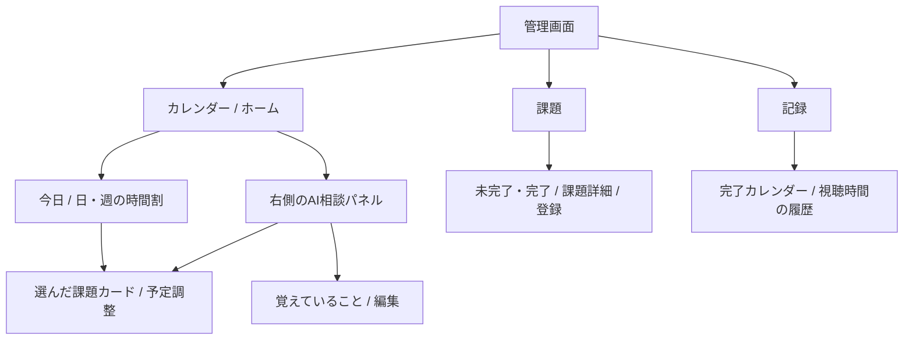
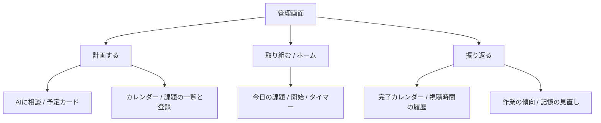

# 管理画面の画面構成・4案

提案日：2026-11-07。現在の「今日の課題／AIに相談／スケジュール／積み上げの記録／設定」を基にする。画面の改修はまだ行わず、入口・情報の置き場所・往復の少なさを比較する。

## 全案で共通にすること

- 右上はChrome風プロフィールメニュー。ログイン、Googleカレンダー連携、プロフィール、通知・表示設定、ログアウトをまとめる。
- 作業開始後は上部の静かなタイマーと細い進捗バーを共通表示する。
- 新しい課題・既存予定・記憶候補は同じカードを再利用し、登録前／確定済み／同期待ちを区別する。AIの提案だけでは保存しない。
- 予定変更は変更前後の確認画面へ進み、手動またはGeminiで修正してから確定する。
- 作業傾向は本人が確認して記憶し、相談画面またはプロフィールから編集・削除する。保存場所は共通とし、画面によって別の記憶を持たない。
- 「課題」はやることと締切、「予定」は実際に取り組む時間割として区別する。

## A：今日の作業を中心にする

今の画面に近い構成。起動時に次の作業を示し、相談と予定は必要なときに開く。

- 主導線：「今日」→次の課題→開始。相談したいときは「AIに相談」。
- よい点：作業へすぐ戻れる。今ある機能・画面を整理して移行しやすい。
- 注意点：相談と予定が別画面なので、予定を見ながらの相談では往復が残る。
- 現状からの変更：「設定」を右上へ移動。「今日」と「予定」の役割を今日の実行と日程管理に分ける。

## B：AIとの会話を中心にする

相談画面をホームにし、必要な操作を会話内のカードとして出す。今日やることも相談画面に固定表示する。

- 主導線：相談→カードの確認・編集→登録・開始。
- よい点：何をどう登録するか迷う人に合う。会話の文脈を保ちやすい。
- 注意点：すぐ作業を始めたい人には会話が余分になる。既存予定の表示・開始ボタンはAI応答を待たずに使える必要がある。
- 現状からの変更：「今日」を独立ページから相談画面の固定領域へ移す。課題の手入力は共通の登録ボタンから残す。

## C：カレンダーを中心に、横でAIへ相談する（推奨）

予定を見ながら、同じ画面の右側で相談する。予定を選ぶと課題カードを開き、AIの変更案と比較する。

- 主導線：予定を確認→横で相談→提案カードを編集→変更前後を確認して確定。
- よい点：「この予定を後ろへ」の対象が分かる。相談とカレンダーを往復せず、カードを操作する価値が伝わる。
- 注意点：狭い画面は分割しない。カレンダーと相談を切り替え、選択中の課題を引き継ぐ。時間割表示とパネル配置の改修が必要。
- 現状からの変更：「今日」と「スケジュール」をカレンダーへ統合。「AIに相談」は独立ページからパネルへ移す。課題の一覧と時間割を分ける。
- 左メニューは「カレンダー／課題／記録」の3つ。作業開始・視聴時間はカレンダー上部で確認する。

## D：計画・実行・振り返りの順にする

使う機能名ではなく、利用者が今したい行動で入口を分ける。

- 主導線：計画する→取り組む→振り返る。
- よい点：サービスが目指す習慣の流れを説明しやすい。作業中の画面を小さく保てる。
- 注意点：目的の機能がどの段階にあるか覚える必要があり、予定や相談へ1階層深くなる。
- 現状からの変更：今ある画面を3グループにまとめ直す。作業傾向の見直しを振り返りに置く。

## 比較と選び方

| 案 | 最初に見えるもの | AIの位置 | 合う使い方 | 主な改修 |
|---|---|---|---|---|
| A | 次にやる課題 | 独立した相談画面 | 毎日すぐ作業へ戻りたい | 今の画面の役割整理 |
| B | 会話と今日の予定 | ホームそのもの | 言葉で予定を考えたい | 相談画面へ今日の操作を統合 |
| C | 日・週の予定 | 右側の相談パネル | 予定を見ながら編集したい | 時間割と相談の同時表示 |
| D | 今の作業 | 計画の中 | 計画から振り返りまで順に使いたい | ナビゲーションのグループ化 |

今回の「相談しながらGoogleカレンダーのカードを編集する」という方向にはCが最も合う。改修量を抑えるならA。Cを選ぶ場合も、会話カード・記憶・予定確認・上部タイマーは再利用し、時間割表示は既存部品を調べてから選ぶ。

採用後は各ページにURLを持たせ、再読み込み・戻る・通知からの直接遷移を揃える。現在の拡張が使う `?notification=` と `?snooze=` は引き続き開けるようにする。これは今回の提案段階では未実装。
