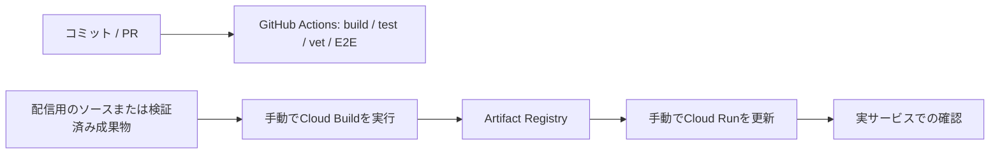

# 運用とCI/CDの現状

記録日：2026-11-06。以下のクラウド設定は配信時に確認した値。秘密情報の実値は含めない。

最新配信は2026-11-07の `dopagaki-security-0b05f11`（100%）、アプリコード `0b05f11`。IAM縮小・AI利用上限・CSP・依存とOS更新を反映し、同じ実行SAでSDK操作とAI疎通1回を確認した。[本番反映の記録](security-rollout-2026-11-07.md)を参照。ローカルで監査したコンテナーtarを既存レジストリへpushし、digest固定で手動配信した。GitHubへのpush・マージやCDは行っていない。

直前の配信は `dopagaki-main-b6dffb4`、main `b6dffb4`。[配信と実Shortsの検証](shorts-verification-2026-11-07.md)を参照。以下の初期配信時の設定・権限は当時の記録として保持する。

前回の配信は管理画面のAI相談を追加した Cloud Run `dopagaki-00013-vtd`（100%）、コード `7b77026`。[変更と実確認の範囲](assistant.md)を参照。Google Chatアプリは無効化し、旧受付APIと専用環境変数を削除した。本人のGoogleアカウント照合とアカウント切替は[一般ユーザー対応の記録](public-accounts.md#配信と実確認)を参照。下記の「初期配信時の環境」と旧digestの配信例は、最初の実サービス確認時点の記録として保持する。

## 整備状況

| 項目 | 状態 | 根拠・範囲 |
|---|---|---|
| CI | 整備済み（変更範囲による実行選択を追加） | [.github/workflows/check.yml](../.github/workflows/check.yml)。PRとmainへのpushで実行。下記の範囲に応じてチェックを選択 |
| Chrome拡張の配布 | タグからReleaseを作成するワークフローを追加 | [release-extension.yml](../.github/workflows/release-extension.yml)。`vX.Y.Z` のpushで型チェック・単体テスト・公開先向けビルド・ZIPとチェックサムの公開を実行。導入は[INSTALL.txt](../extension/INSTALL.txt)参照。初回のGitHub上の実行結果はPR・Actionsで確認 |
| Cloud Runへの配信 | 手動で実施済み | Cloud Buildでイメージ作成後、CLIでCloud Runを更新 |
| CD | 未整備 | この開発でmainへのマージ等を起点にした自動デプロイを設定していない |
| Terraform / IaC | 未導入 | Terraformコード・state管理・importは用意していない |
| 配信設定の共有 | 一部あり | Dockerfile、公開環境変数の例、Firestoreルール、README |
| 再現可能な一連の運用 | 未完成 | Firebase・OAuth・Chat・IAM等を含む初期設定全体はCLI・画面操作に依存 |

Cloud Buildを使ったことと、CI/CDが整備されていることは同じではない。現状のCIは検証を自動化しており、配信は人が実行する。



CI成功からCloud Run更新へ自動でつながる経路はまだない。Chrome拡張のタグからGitHub Releasesへの自動公開はCloud Run配信とは別のワークフローで、インストール済み拡張の自動更新は行わない。

## CIの実行範囲

PRと `main` へのpushで `check` を実行する。作業ブランチへのpushでは起動せず、同じPR・ブランチに新しい変更が来たら古い実行をキャンセルする。PRはPR全体の差分、mainへのpushはpush前からの差分を判定する。

| 変更箇所 | 実行するチェック |
|---|---|
| `web/`・`extension/`・`shared/`・拡張ビルドスクリプト・npm依存・Angular/TypeScript設定 | ビルド、拡張の型確認、Node単体テスト、E2E |
| `api/` | Go raceテスト、vet、ビルドとE2E（APIとWeb・拡張の連携を確認） |
| `tests/*.test.ts` のみ | Node単体テスト |
| `tests/e2e/`・`playwright.config.ts` のみ | ビルドとE2E |
| CIワークフロー | すべて |
| 資料・画像など上記の対象外のみ | 変更範囲の判定のみ。依存のインストール・ビルド・テストは省略 |

複数の範囲を変更した場合は、該当するチェックをすべて実行する。資料だけのPRでも `check` の結果を残すため、ワークフロー全体をパス条件で除外せず、各ステップを条件付きで実行する。配信設定の変更検証や自動デプロイは含まない。この実行選択の追加後のGitHub Actions実行結果は未確認。

## 初期配信時の環境

| 項目 | 値 |
|---|---|
| プロジェクトID | `devfest-2026-513816` |
| プロジェクト番号 | `1032251723022` |
| Cloud Runサービス | `dopagaki` |
| Cloud Run / Firestore / Artifact Registryのリージョン | `asia-northeast1` |
| Vertex AIのlocation | `global` |
| 公開URL | https://dopagaki-1032251723022.asia-northeast1.run.app/ |
| 配信コード | `a25837c` |
| リビジョン | `dopagaki-00006-btr` |
| 配信割合 | このリビジョンへ100% |
| CPU / メモリー | 1 CPU / 512MiB |
| 最小 / 最大インスタンス | 0 / 2 |
| 同時実行数 / リクエスト上限時間 | 40 / 60秒 |
| Calendar監視更新 | `dopagaki-calendar-renew`、毎日09:00、`Asia/Tokyo` |

初期確認時の配信イメージ：

```text
asia-northeast1-docker.pkg.dev/devfest-2026-513816/dopagaki/app@sha256:96a02db958e38e38cc56c97510c0f5f020fe75c9cb63d4b446186be1241bce25
```

課金アカウントと予算はユーザーが設定した。この開発で変更していない。予算通知等の設定内容を棚卸しした記録でも、1万円で必ず課金が停止することを検証した記録でもない。

## 初期設定で必要だったもの

1. Cloud Run、Cloud Build、Artifact Registry、Firestore、Firebase Authentication、Secret Manager、Vertex AI、Calendar、Chat、Cloud Scheduler等のAPIを有効にした。
2. 既存のGoogle CloudプロジェクトへFirebaseを追加した。別のプロジェクトは新規作成しなかった。
3. FirebaseのWebアプリとGoogleログインを設定し、公開Cloud Runドメインを認証の許可ドメインへ追加した。
4. OAuthクライアントに公開オリジンと `/api/calendar/callback` を登録した。Firebaseログイン用の既存redirect URIも保持した。
5. Firestore Nativeを用意し、[クライアントルール](../deploy/firestore.rules) を全拒否にした。
6. 実行用とビルド用のサービスアカウントを分けた。
7. Secret ManagerへOAuth client secretとScheduler用Secretを登録した。ユーザー別Calendarトークンは接続時にアプリが保存する。
8. 個人用の未公開Chatアプリを設定し、HTTPの共通エンドポイントを `/api/chat` にした。
9. Calendar監視更新のSchedulerを設定して実行した。

Firebase初回の規約同意、OAuthの個人アカウントの同意、未公開Chatアプリと開発中のChrome拡張の追加では、利用者による確認・操作が発生した。これらも含めた完全無人の初期構築はできていない。

## 権限の分担

| 対象 | 配信時の設定 |
|---|---|
| `dopagaki-runtime` | `roles/datastore.user`、`roles/aiplatform.user` |
| 同上、Secretの作成 | `secretmanager.secrets.create` のみを含むカスタムロール。作成権限はプロジェクト単位 |
| 同上、Secretの読み取り・バージョン追加 | `roles/secretmanager.secretAccessor`、`roles/secretmanager.secretVersionAdder`。`dopagaki-` 接頭辞のリソース名に条件を限定 |
| `dopagaki-build` | `roles/run.builder` |
| Cloud Run `dopagaki` | サービス単位で `allUsers` のInvokerを許可。静的画面と外部からのWebhook受信のため公開 |
| 個人データ用API | 公開HTTP到達性とは別に、Firebaseの認証を検証 |

各SAの完全な名前は `<SA名>@devfest-2026-513816.iam.gserviceaccount.com`。他アプリ・他プロジェクトの権限を変更する作業は対象にしていない。

Secret読み取り・追加の条件は、配信時には次の形式を使った。

```text
resource.name.startsWith('projects/1032251723022/secrets/dopagaki-')
```

接頭辞の条件は作成権限そのものを限定するものではない。この違いを「すべてのSecret操作を接頭辞で制限した」と説明しない。

## OAuth・AI相談・Scheduler

| 設定 | 扱い |
|---|---|
| Calendarスコープ | `openid`、`email`、`https://www.googleapis.com/auth/calendar.app.created` |
| Calendarコールバック | 公開URLの `/api/calendar/callback` |
| OAuth client secret | `dopagaki-calendar-oauth` をSecret参照で注入 |
| ユーザー別OAuthトークン | `dopagaki-calendar-` で始まるSecret。実値は記録しない |
| AI相談 | Firebase認証済みの `/api/assistant`。会話はFirestoreの `assistantConversations/{uid}/turns` |
| 旧Google Chat | アプリのステータスを「無効」に保存。`POST /api/chat` は404。既存の旧記録・APIサービスは削除していない |
| Scheduler | `POST /api/calendar/renew`。`dopagaki-scheduler` の値をBearerとして使う |

Firebaseログインと、Calendarの継続アクセスへのOAuth同意は別の操作。ログイン済みでも、Calendarの連携・トークン保存・専用カレンダー作成まで終わったとは限らない。

## 手動配信の再現に必要な情報

[Dockerfile](../Dockerfile) はAngularのビルド、Goのビルド、distrolessの非root実行イメージを作る。最初の配信と `3f33f90` の配信では、Cloud Buildでソースからこのコンテナーを作成した。

後半のChat調査・最終修正では、ローカルで `GOOS=linux GOARCH=amd64 CGO_ENABLED=0` のGoバイナリーとAngular成果物を作り、Cloud Buildで実行イメージへ梱包した。配信コードに対するCIは通したが、最終リビジョンの作成経路を「GitHub CIが本番イメージを作って自動配信した」と説明しない。

今後ソースから配信する際のCloud Build設定例は次の形。現在、これが自動で実行される設定はない。

```yaml
steps:
  - name: gcr.io/cloud-builders/docker
    args: [build, -t, '${_IMAGE}', .]
images: ['${_IMAGE}']
options:
  logging: CLOUD_LOGGING_ONLY
timeout: 1200s
```

設定をローカルの `cloudbuild.yaml` に置き、実行用の環境変数ファイルを [設定例](../deploy/cloudrun.env.example.yaml) から用意する。公開設定のみをファイルに入れ、秘密値はSecret Manager参照にする。以下は説明用のコマンドで、この記録の作成時には実行していない。

```bash
DOPAGAKI_PROJECT=devfest-2026-513816
DOPAGAKI_REGION=asia-northeast1
DOPAGAKI_TAG=$(git rev-parse --short HEAD)
DOPAGAKI_IMAGE="$DOPAGAKI_REGION-docker.pkg.dev/$DOPAGAKI_PROJECT/dopagaki/app:$DOPAGAKI_TAG"

gcloud builds submit . \
  --config=cloudbuild.yaml \
  --substitutions="_IMAGE=$DOPAGAKI_IMAGE" \
  --service-account="projects/$DOPAGAKI_PROJECT/serviceAccounts/dopagaki-build@$DOPAGAKI_PROJECT.iam.gserviceaccount.com" \
  --region="$DOPAGAKI_REGION" \
  --project="$DOPAGAKI_PROJECT" \
  --billing-project="$DOPAGAKI_PROJECT"
```

本番更新では、完成したイメージのdigestを確認して固定する。`gcloud run deploy` へ、実行用SA、環境変数ファイル、Secret参照、リソース上限を明示する。OAuthとSchedulerのSecretバージョンは、使用するものを確認して指定する。手動配信後は [検証記録](verification-2026-11-06.md) の範囲で確認する。

次は2026-11-06の初期確認時の配信値で、旧イメージを再配信するコマンド例。新しいビルドを配信する場合は、その結果のdigestへ置き換える。Secretの `:1` も配信時点の値である。

```bash
gcloud run deploy dopagaki \
  --image=asia-northeast1-docker.pkg.dev/devfest-2026-513816/dopagaki/app@sha256:96a02db958e38e38cc56c97510c0f5f020fe75c9cb63d4b446186be1241bce25 \
  --service-account=dopagaki-runtime@devfest-2026-513816.iam.gserviceaccount.com \
  --env-vars-file=.local/cloudrun.env.yaml \
  --update-secrets=SCHEDULER_SECRET=dopagaki-scheduler:1,GOOGLE_OAUTH_CLIENT_SECRET=dopagaki-calendar-oauth:1 \
  --min-instances=0 --max-instances=2 \
  --cpu=1 --memory=512Mi --concurrency=40 --timeout=60 \
  --region=asia-northeast1 \
  --project=devfest-2026-513816 \
  --billing-project=devfest-2026-513816
```

配信に使った一時設定・補助スクリプトは `.local/` にあるが、Git管理していない。これらの存在だけでは第三者が同じ環境を再構築できないことが、現在の運用上の不足。

## TerraformとCDを整備するときに決めること

以下は未実施の作業一覧で、導入済みの仕組みではない。

| 項目 | 必要な判断・確認 |
|---|---|
| Terraformの管理範囲 | 既存のRun、Registry、Firestore、SA/IAM、Secretの器、Scheduler等を棚卸しし、リソースごとにprovider対応とimport可否を確認する |
| 既存環境の取り込み | 作成済みのものを重複作成・置換しないよう、import後にplanで差分を確認する |
| state管理 | 保存場所、アクセス権、ロック、運用者を決める。秘密情報をstateへ入れるかも個別に判断する |
| Firebase・OAuth・Chatの画面設定 | どこまでコードで管理できるか未調査。すべてTerraform化できるとはまだ言えない |
| GitHubからGoogle Cloudへの認証 | 認証方式、配信用SA、対象ブランチと権限を決める。現在GitHub向けの配信認証は未設定 |
| 自動配信の起点 | mainマージ、タグ、手動実行等のどれを使うか決める |
| 配信前後の確認 | CI結果と配信イメージの対応、実行環境、ヘルスチェック、失敗時の扱いを定義する |
| ロールバック | アプリのリビジョン切替と、データ・設定の復元を分けて手順化する。現時点で復旧訓練は未実施 |
| 拡張の配布 | GitHub ReleasesでZIPを配布し、Chromeへunpackedで導入する。Store配布とインストール済み拡張の自動更新は未実施 |

この一覧を作ったことでTerraformやCDが整備済みになるわけではない。実装・適用・実行確認が終わったものだけ、上の整備状況を変更する。
