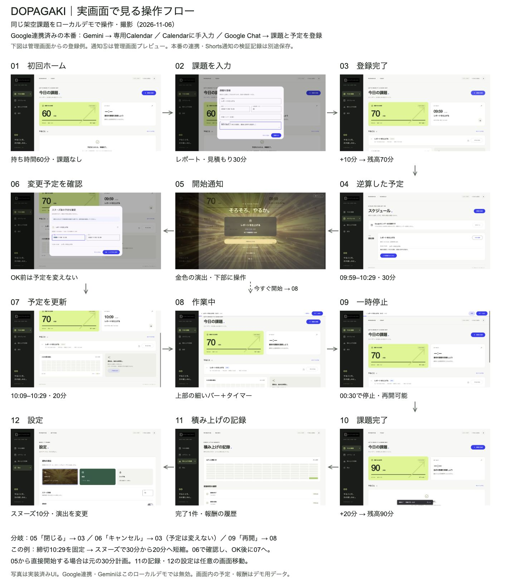

# 実画面で見る操作フロー

2026-11-06撮影。実装済みのAngular画面とGoのデモ用バックエンドを使い、同じ架空課題「レポートを仕上げる」を操作した。画面の内容は画像生成や描き直しではない。

図は01から矢印順に読む。2・4行目は右から左。番号は説明用であり、製品の画面IDではない。

## 主な流れ

初回60分から、課題登録で10分を受け取り70分になる。見積もり30分、締切10:29から、09:59開始の予定を作る。

開始通知からスヌーズを選ぶと、変更予定の確認を開く。この例では開始を10分遅らせ、締切を固定するため10:09–10:29の20分へ短縮する。30分の作業時間を確保したまま10分遅らせる例ではない。確認画面で時刻を手動修正でき、OKを押すまで元の予定を変えない。

作業開始後は上部にタイマーと細いプログレスバーを出す。一時停止・再開ができ、完了すると20分を受け取り90分になる。記録と設定は任意の画面移動で、毎回開く必要はない。

## 分岐

| 操作元 | 操作 | 遷移先・結果 |
|---|---|---|
| 03 ホーム / 05 通知 | はじめる | 08 作業中。スヌーズ前なら30分の計画を使う |
| 05 通知 | スヌーズ10分 | 06 変更予定の確認 |
| 05 通知 | 閉じる | 03 ホーム。予定はそのまま |
| 06 確認 | OK | 07 予定更新。この例は20分へ短縮 |
| 06 確認 | キャンセル | ホーム。元の30分の予定を維持 |
| 08 作業中 | 一時停止 | 09 停止中 |
| 09 停止中 | 再開 | 08 作業中 |
| 08 / 09 | 完了 | 10 完了、視聴可能時間を20分加算 |

キャンセルの遷移先は、今回撮影した管理画面の通知プレビューでの挙動。Chrome拡張の全画面通知と同じ戻り先とみなさない。

## 元の画像

| 番号 | 実画面 | 注目する箇所 |
|---|---|---|
| 01 | [初回ホーム](assets/screen-flow/01-home-empty.jpg) | 課題なし、60分 |
| 02 | [課題入力](assets/screen-flow/02-task-input.jpg) | タイトル、締切、見積もり、メモ |
| 03 | [登録完了](assets/screen-flow/03-registered.jpg) | 70分、開始09:59 |
| 04 | [スケジュール](assets/screen-flow/04-schedule.jpg) | 30分の具体的な予定 |
| 05 | [通知プレビュー](assets/screen-flow/05-notification-preview.jpg) | 金色の演出、下部の横長ボタン |
| 06 | [スヌーズ確認](assets/screen-flow/06-snooze-confirm.jpg) | 変更前後、時刻入力、OK |
| 07 | [予定更新](assets/screen-flow/07-plan-updated.jpg) | 開始10:09、20分、元の見積もり30分 |
| 08 | [作業中](assets/screen-flow/08-working.jpg) | 上部のバーと00:30 / 20分のタイマー |
| 09 | [一時停止](assets/screen-flow/09-paused.jpg) | 00:30で停止、再開ボタン |
| 10 | [完了](assets/screen-flow/10-completed.jpg) | 90分、完了1件、+20分の通知 |
| 11 | [記録](assets/screen-flow/11-record.jpg) | 初回・登録・完了の履歴 |
| 12 | [設定](assets/screen-flow/12-settings.jpg) | 演出、スヌーズ10分 |

## 撮影条件と確認範囲

- 対象の製品コード：`a25837c`。以降の変更は開発記録の追加。原画像はChromeの通常ビューポート1445×737のJPEGで保存した。
- ローカルの `APP_MODE=demo` で撮影。本番の予定・残高・設定は変更していない。Googleカレンダーは未連携、Gemini呼び出しも無効のため、画面内の連携状態はそのまま写っている。
- 05は管理画面の「通知を試す」から手動で開いた。本番で予定時刻にShortsへ自動通知された瞬間の写真として使わない。
- 本番の3経路（Geminiアプリ経由の専用Calendar、Calendarへの手入力、Google Chat）と実Shorts通知は、別の[実サービス検証記録](verification-2026-11-06.md)を参照。[本番通知の写真](assets/notification-2026-11-06.jpg)も保存済み。
- 元画像12枚は加工せず、全体図に縮小配置した。対話表示の拡大は同じ画像の表示範囲を切り替える。
- 対話表示は通常幅736pxの明色、360pxの暗色で配置・画像読み込み・横はみ出しがないことを確認。画像選択、スヌーズ分岐、キャンセル、画面全体表示も確認した。これはフロー図の表示確認であり、製品コードの新たな本番検証ではない。

課題・予定・報酬・遷移先と撮影条件は [screen-flow.json](screen-flow.json) にも保存している。再撮影する場合は当日の架空課題を使い、同じセッションで最後まで操作する。過去の写真と異なる課題・残高を混ぜない。全体図を更新するときも、通知の実行方法とGoogle連携の有効・無効を明記する。
