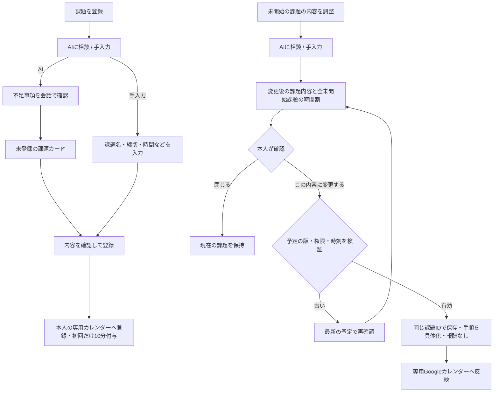

# 課題の登録と内容調整

2026-11-07、カレンダー中心の管理画面に追加した変更。PR #7に含める。本番の反映結果とは区別する。

## 入口と操作

「課題を登録」のダイアログ内で「AIに相談／手入力」を選ぶ。初期表示は従来どおり手入力。AIは既存の会話・カードを再利用し、入力の一括解析だけに限定しない。情報不足なら会話で聞き返し、候補カードを確認して登録する。切替時は両方の未送信入力を残す。

登録済みの未開始課題では、一覧の「内容を調整・AIに相談」またはカレンダー詳細の「課題の内容を調整」を押す。初期表示はAIで、対象のID・現在の内容・予定を相談へ渡す。手入力へ切り替えることもできる。従来の「予定・手順を調整」は開始終了や順番の調整として残す。

## 保存の境界

- `TaskDialog`は登録と内容編集で同じ入力・会話部品を使う。作業中・完了済みの課題の内容編集は受け付けない。
- AIは`update`カードへ`taskId`と変更後の入力全体を返す。サーバーは本人の課題を引き直し、入力を検証する。モデルが返したIDで新しい課題を複製しない。
- `POST /api/tasks/{id}/preview`はコピー上で逆算し、`TaskEdit`（inputとDraft）を返す。課題・台帳・報酬を保存しない。
- カードの「この内容に変更する」から`PUT /api/tasks/{id}`を送る。プレビュー時の予定版を確認し、変更した内容に合う具体的な手順を作る。AIの応答待ちの間に予定や作業傾向が変わった場合も保存を拒否する。
- 保存時はクライアントから送られた時間割をそのまま信頼せず、本人の状態と入力から再計算する。登録時のID・作成日時・完了状態・台帳を維持し、登録報酬を付け直さない。
- 手入力を直したら古い確認カードを消す。処理中は入力・切替・重複送信を無効にし、読み込みを表示する。通信失敗時は入力と提案を残す。
- 課題が別の画面で削除されても、編集画面を登録操作へ切り替えて復活させない。

作業手順の具体化は保存時に行う。確認カードでは課題内容と全未開始課題の変更前後の時間を示す。最終的な手順そのものを事前承認する機能ではない。

## Googleカレンダーへの反映

内容編集では、その課題の専用イベントのタイトル・メモ・終了（締切）・開始（締切−必要分数）を更新する。逆算した実際の作業時間と手順は従来どおり詳細欄の`[DOPAGAKI]`へ書く。他の課題の時間割が変わった場合も、その詳細欄を更新する。普段のGoogleカレンダー全体を表示する変更ではない。

通常の時間割調整では、引き続き詳細欄だけを更新し、Google側のタイトルや開始終了を動かさない。

FirestoreとCalendar APIは同一トランザクションにできない。確定済みの内容変更を`calendarInputPending`で保持し、Googleへの反映成功後に解除する。反映に失敗した場合は管理画面の保存状態を読み直し、「管理画面には保存済み・Googleへの反映未確認」を表示する。同期時は保留中の内容を先に送信し、Webhookで古いイベントを読み戻して変更を失わないようにする。

ETagと入力ハッシュでGoogle側の同時変更を検出する。Googleへの保存だけ成功して応答を失った場合は、同じ内容の再送を許可する。Googleが時刻のタイムゾーン表記や小数秒を正規化しても同一の時刻としてハッシュを比較し、成功後はAPIが返したイベントのハッシュを保持する。Google側で異なる内容に編集された競合では自動上書きを止める。**この競合のマージ・どちらを採用するかを選ぶUIは未実装**で、単純な再試行だけでは解消しない。Google側を管理画面の確定内容に合わせた後の再同期など、内容の一致を確認して解決する必要がある。

IAM・OAuthスコープ・Secret・Firestoreコレクションの追加はない。

## 検証と知見

ローカルの本番ビルド、TypeScript単体4件、Go race/vet、既存機能を含むE2E12件が成功した。最後に削除済み課題の扱いを補強し、登録・内容編集の3件を再実行した。AI応答はローカルHTTPまたはブラウザーの模擬応答で、保存はデモAPIの実装を使う。有料Gemini API、実ユーザーのGoogle予定、本番環境ではこの変更を確認していない。

追加の回帰確認は次のとおり。

- 登録ボタンからのAI相談と手入力、両方の下書き保持、応答中の閉じる操作・二重送信の抑止。
- 提案・プレビュー・キャンセルで課題や報酬が変わらない。
- 内容変更で同じ課題IDと作成日時を保持し、報酬を重複付与しない。
- 他ユーザーの課題のプレビュー・保存、AIが返した存在しない課題IDを拒否。
- 古い予定版、開始済み課題、締切に収まらない時間割を拒否。
- AIの応答待ち中に作業傾向が変更された場合に上書きしない。
- 失敗した保存を成功表示せず、提案を残して再試行できる。
- 手入力を直した後は確認カードを作り直す。
- Google向けの内容変更と詳細欄だけの変更を区別し、外部編集を上書きしない。同じGoogle更新が成功済みの場合は再送できる。

既存のスマホ幅テストで、リサイズ直後の1回だけの判定が失敗した。FullCalendarの再描画と判定のタイミングを分けるため、固定sleepではなくPlaywrightの`expect.poll`で収まることを待つようにした。12件の再実行で成功した。

| 画面 | 証跡 |
|---|---|
| 登録ダイアログからのAI相談と候補カード | [registration-ai.png](assets/task-input/registration-ai.png) |
| 課題の内容を指定したAIの変更案 | [content-ai.png](assets/task-input/content-ai.png) |

証跡は架空課題・模擬AI応答を使った実Angular画面。個人情報は含まない。
