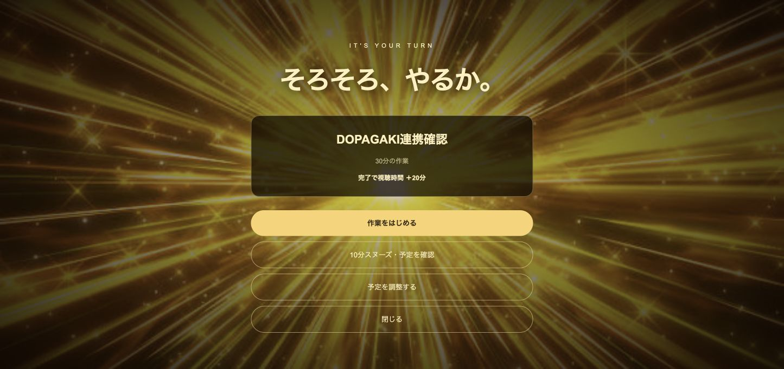
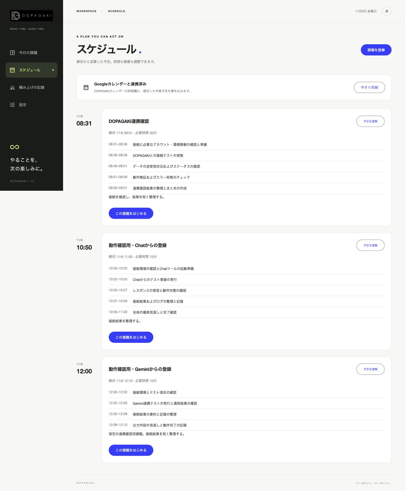

# 検証記録：2026-11-06

この記録は架空の課題を使った機能確認。利用習慣の改善や学習効果を評価した実験ではない。

## 対象と証拠

| 項目 | 対象 |
|---|---|
| 最終配信コード | `a25837c` |
| 最終リビジョン | `dopagaki-00006-btr` |
| 公開先 | https://dopagaki-1032251723022.asia-northeast1.run.app/ |
| ローカル環境 | macOS arm64、Node.js 24.22.1、Go 1.27.3 |
| ローカルE2E | Playwrightのテスト用Chromium。Shortsは合成DOM |
| 実環境 | Googleログイン、Google Calendar、Geminiアプリ、Google Chat、Cloud Run、Firestore、Vertex AI、Secret Manager、Scheduler、実Chrome拡張と実YouTube |
| コード・説明 | [PR #1](https://github.com/a-sumikawa/devfest-2026/pull/1) |
| 機能修正時のCI | [d523947 のCheck](https://github.com/a-sumikawa/devfest-2026/actions/runs/42128847897)、成功 |
| 最終配信コードのCI | [a25837c のCheck](https://github.com/a-sumikawa/devfest-2026/actions/runs/42129798930)、成功 |

## 自動試験

実行した基本コマンド：

```bash
npm run build
npm test
(cd api && go vet ./...)
npx playwright install chromium
npm run test:e2e
```

`npm test` は拡張のTypeScript型チェック、Nodeの時刻計算テスト、Goのrace付きテストを実行する。CIではChromiumの依存パッケージも導入する。通常の試験は有料の外部AIを呼ばない。

| 分類 | 主な確認 | 結果 |
|---|---|---|
| 時刻計算 | タイムスタンプからの復元、確定した短縮後の予定時間による進捗 | 成功、Node 2件 |
| 状態・報酬 | 並行再送、登録・完了の重複防止、視聴receipt、利用者分離、ロールバック | Go race付きで成功 |
| 予定 | 逆算、手順の連続、スヌーズ確認、競合、重複、確定した順番 | 成功 |
| Calendar変換 | 元のメモ保持、再送・編集・削除、終日・繰り返しの除外 | 成功、ローカルのイベントデータを使用 |
| AI応答の検証 | 本人の作業傾向が渡る、合計時間が不正な応答を拒否 | 成功、ローカルHTTP応答を使用 |
| Chatイベント | 実サービスで見つけた人数 `1.0` を含むイベント、応答の構造、未認証の拒否 | 成功 |
| 画面・拡張E2E | 下記5件 | CIで5件成功 |

E2Eの5件：

1. 登録、通知プレビュー、確認のキャンセル、割当時間の短縮、タイマー、一時停止の復元、完了報酬。
2. スヌーズの確定、設定変更、狭い画面の横スクロール確認。
3. 保存が失敗したときのローディング・二重送信防止・入力保持。
4. 通知リンクで遅延読込を待ち、直接スヌーズ確認を開く操作。
5. unpacked拡張の接続、前面Shortsの計測、開始通知、作業バー。動画画面は合成DOM。

`TestLiveGeminiPlanning` は通常はスキップする。明示的に `DOPAGAKI_LIVE_GCP=1` を設定して実行したときだけ、ログイン済みの操作アカウントからVertex AIへ架空の課題を送る。この単体の実接続成功と、後のCloud Run実行アカウントでの成功を区別した。

## 実サービスで行った確認

| 対象 | 操作・観測 | 確認できたこと |
|---|---|---|
| 公開API | `/api/health` が200、未認証の `/api/state` が401 | 公開到達性と、個人データ用APIの認証の一例 |
| Googleログイン | 指定の個人アカウントでログイン。別のChromeプロフィールでも新規ログイン | 初回データ取得と残高60分の表示。認証競合の修正後にも確認 |
| Firestore | 再読み込みとCloud Run更新をまたいで予定・残高を確認 | APIプロセスのメモリーだけに依存していないこと |
| Calendar OAuth | 本人の同意後に専用カレンダーが作成され、連携済み表示 | 指定アカウントの接続。ユーザー別Secretの作成・利用も通った |
| API内部のGemini | 管理画面から文章入力、手順の具体化、Geminiへの予定調整指示 | Cloud Run実行用SAによるVertex AIの実呼出し |
| Calendarへの書き戻し | 専用Calendar APIで確認用イベントを取得 | 元のメモと具体的な手順が詳細欄に存在 |
| Calendarからの入力 | 専用Calendar APIで架空予定を1件作成 | 変更通知から自動取り込み、手順の詳細欄反映、登録報酬 |
| Geminiアプリからの入力 | DOPAGAKIカレンダーを明示し、架空予定を作成 | Gemini側の作成カード、その後のCalendar実データ、管理画面への自動取り込み |
| Google Chatからの入力 | 個人用Chatアプリへ課題名・日時・分数を送信 | 登録完了の実返信、Calendarに1件だけ存在、詳細欄の手順、登録報酬 |
| Shorts計測 | 拡張の入った同じChromeプロフィールで、実YouTubeを前面再生 | 残高が計50秒減少。停止後の安定した残高も確認 |
| 時刻通知 | 予定の開始時刻に実Shorts上へ表示 | 金色の全画面通知、作業時間、下部の横長だ円ボタン |
| スヌーズ | 事前候補を開き、手動で時刻を編集 | OK前には確定予定が変わらず、OK後にFirestoreとCalendarへ保存 |
| 作業 | 開始、一時停止、再読み込み、本人による完了 | 上部の細いバー、確定した2分を使うタイマー、停止状態の復元、20分付与 |
| 既存Calendar予定の更新 | 確認用イベントの日時を変更 | 新しい日時へ同期し、登録報酬は4件のまま。変更した08:31に再通知 |
| Scheduler | 毎日09:00の更新ジョブを設定し、手動起動 | 更新エンドポイントの実行成功。6日間経過後の継続運用試験ではない |

## 報酬と視聴時間の観測値

Chat登録直後に、指定アカウントのDOPAGAKI状態から確認した値：

| 内訳 | 秒 | 表示上の意味 |
|---|---:|---|
| 初回 | 3,600 | 60分 |
| 新規登録4件 | +2,400 | 10分 × 4件 |
| 完了1件 | +1,200 | 20分 |
| 実Shortsの消費 | −50 | 前面再生分の確認 |
| 残高 | 7,150 | 119分10秒 |

課題は計4件、そのうち完了は1件、Calendar同期状態は `synced` だった。既存予定の更新後も登録報酬の件数は4件で増えなかった。

これは確認時点のスナップショットで、現在の残高を保証するものではない。小数秒単位の精度や、長時間の累積誤差を測定したものでもない。報酬と視聴時間の再送については、自動試験による確認も別にある。

アカウント識別子や認証情報を含まない[確認値のJSON](verification-2026-11-06.json)も保存した。Chat登録直後の確認は `dopagaki-00005-wt2` で行い、その後の最終表示修正は `dopagaki-00006-btr` で確認した。

## 配信の追跡

| コード | 主な変更 | 配信 |
|---|---|---|
| `629841a` | 初回MVP | 初期Cloud Run配信。Calendar設定の追加後は `dopagaki-00002-qqb` |
| `3f33f90` | ログイン競合、Chatのアドオン形式 | `dopagaki-00003-9jd` |
| 調査中の未コミット差分 | Chatの本文を残さない診断ログ | `dopagaki-00004-skf`。原因の特定用 |
| `d523947` | Chatの実イベント型、確定作業時間の表示、回帰試験 | `dopagaki-00005-wt2` |
| `a25837c` | 通知下部のボタンをだ円形へ統一 | `dopagaki-00006-btr`、最終確認対象 |

`3f33f90` の完全ソースビルドはCloud Build `2fbbd281-f5d1-41ca-b404-707ba0731a7b`。最終成果物の梱包はCloud Build `937fc049-8f2e-46b1-b969-f0c367a25815`。後半はローカルビルド成果物を梱包しており、CIによる本番自動配信ではない。

## 共有用の画面

発表用の素材選びができるよう、DOPAGAKIと架空課題だけが写る実画面を保存した。画像生成によるモックアップではない。

### 実YouTube上の通知



### 3経路の登録結果がある管理画面



ローカルには作業バー、Chat返信、Gemini作成カード等の追加の画面も保存した。これらはGit管理外であり、他のUIや個人情報が写る可能性があるため、そのまま共有用にはしていない。

## 確認していないこと

- Googleカレンダーの一般画面での手入力操作そのもの。今回は専用Calendar APIからの作成で同期経路を確認した。
- 利用時間の長期的な減少、学習・作業の成果、複数利用者を対象にした効果測定。
- AIの全入力に対する正答率、モデル間比較、実利用者の作業傾向による改善率。
- 複数端末、長期間、OSごとの通知遅延・計測精度の網羅的な試験。
- 監視チャンネルの有効期限を実際にまたぐ長期間の連続運用。
- 負荷試験、可用性評価、バックアップからの復元訓練、独立したセキュリティ評価。
- Chatの一般公開、他アカウントへの配布、Chrome Web Storeからのインストールと更新。
- Terraformによる再構築、mainマージからの自動デプロイ、CDの失敗・ロールバック試験。
- コールドスタート、操作待ち時間、通知から確認画面までの時間の統計的な測定。

実装や設定があることと、これらが実証されていることは別として扱う。
